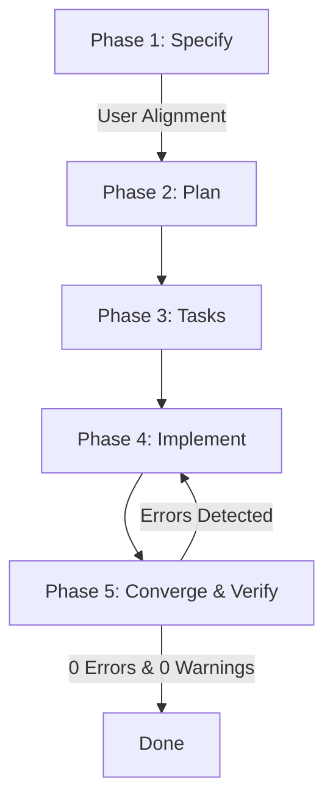

# Spec-Driven Development (SDD) Skill

This skill enforces the **Spec-Driven Development** methodology across the `hono-commerce` monorepo. It replaces unguided "vibe coding" with a deterministic, spec-first workflow inspired by GitHub Spec-Kit.

---

## 1. When to Trigger This Skill

Trigger the SDD workflow whenever:
- The user asks to build or implement a new feature (e.g., *"build product reviews"*, *"add invitation flow"*, *"setup cdn pipeline"*).
- A task involves cross-package changes (`packages/types`, `packages/db`, `apps/api`, `apps/dashboard`).
- A new database entity, route endpoint, or complex state machine is being introduced.

**Do NOT trigger for**:
- Minor 1-line bug fixes or typo corrections.
- Simple styling tweaks in an existing component.
- Updating documentation or comments.

---

## 2. The 5-Phase SDD Protocol

Whenever a feature request is initiated, execute the following phases in strict order:



### Phase 1: Specify (`docs/specs/<NNN-feature>/spec.md`)
1. Create directory `docs/specs/<NNN-feature-name>/`.
2. Copy `docs/specs/_template/spec.md`.
3. Fill in:
   - **User Stories & Acceptance Scenarios** (Given-When-Then format).
   - **RFC 2119 Invariants** (`MUST`, `MUST NOT`, `SHOULD`).
   - **Security Boundaries** (RBAC permissions, tenant isolation).
   - **Edge Cases & Failure Modes**.
4. **Pause and align with the user**: Present the specification summary and ask for feedback before writing implementation code.

### Phase 2: Plan (`docs/specs/<NNN-feature>/plan.md`)
1. Copy `docs/specs/_template/plan.md`.
2. Fill in:
   - **Package Impact Matrix**: Identify every package in the monorepo touched.
   - **Contracts**: Define Zod request input schemas and route keys in `@hono-commerce/types`. In accordance with ADR-005, response types are inferred directly from Hono route endpoints using `InferResponseType` (no hand-written response DTOs).
   - **Database Changes**: Tables, foreign keys, and indexes in `packages/db`.
   - **API Endpoints**: Exact paths, HTTP methods, and validation middlewares in `apps/api`.
   - **UI Views**: Routes and composite modules in `apps/dashboard` or `apps/storefront`.

### Phase 3: Tasks (`docs/specs/<NNN-feature>/tasks.md`)
1. Copy `docs/specs/_template/tasks.md`.
2. Break the implementation down into ordered, checkable tasks with explicit validation criteria.

### Phase 4: Implement (Contract-First Execution)
Execute tasks sequentially:
1. **Contract First**: Implement Zod request input schemas and route keys in `packages/types`.
2. **Database Schema & Migrations**: Add schemas in `packages/db`, generate and test migrations.
3. **Backend API**: Build endpoints in `apps/api` using `zValidator` and tenant isolation `where(eq(table.tenantId, tenantId))`.
4. **Frontend UI**: Build pages using Base UI components and typed hooks consuming inferred response types via Hono RPC (`InferResponseType`).

### Phase 5: Converge & Verify
Run the automated verification suite before marking the task complete:
```bash
bun run verify
```
This runs:
- `oxlint` (Static analysis)
- `oxfmt --check` (Code formatting)
- `turbo run check-types` (Monorepo TypeScript validation across all 10 packages)

**Invariant**: Maintain **0 warnings and 0 errors**. If any check fails, fix the code immediately against the specification.

---

## 3. Standard Invariants to Enforce in Every Spec

Every specification generated by this skill MUST uphold the global repository invariants in `AGENTS.md`:
1. **Tenant Isolation**: Every tenant-scoped entity MUST have `tenantId` and a composite index `(tenant_id, ...)`.
2. **Money**: All monetary values MUST be stored as integer cents (`priceInCents`).
3. **Decoupled Queues**: Never import BullMQ into route handlers. Use publishers from `@hono-commerce/queue`.
4. **Base UI Composition**: Never use Radix `asChild`. Always use `@base-ui/react` with the `render` prop.
5. **No Type Assertions**: Never use `as Route` or `as any`. Use accurate typing in `@hono-commerce/types`.
6. **No Build in Verification**: Never run `bun run build` during routine development verification; use `bun run verify`.
7. **Hono RPC Response Inference (ADR-005)**: Never write redundant manual response DTOs. Response types MUST be inferred directly from Hono endpoints via `InferResponseType`.
