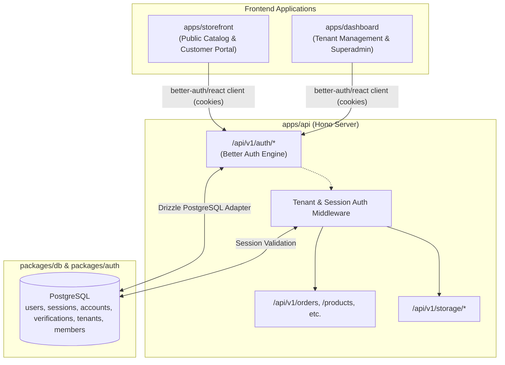
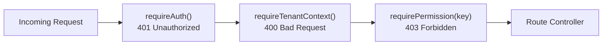

# Authentication Architecture & Multi-Tenant Session Management

This document defines the end-to-end authentication, session management, and authorization architecture across all applications in the `hono-commerce` monorepo.

---

## 1. High-Level Architecture Overview

Authentication is centralized on **Better Auth** with the **Drizzle PostgreSQL adapter**, executed inside the core backend API (`apps/api`), and consumed by the frontend applications (`apps/storefront` and `apps/dashboard`).



---

## 2. Server Configuration (`packages/auth` & `apps/api`)

### Server Engine Mount (`apps/api/src/index.ts`)

Better Auth routes are mounted natively on Hono at `/api/v1/auth/*`:

```ts
// apps/api/src/index.ts
import { auth } from "@hono-commerce/auth";

app.on(["POST", "GET"], "/api/v1/auth/*", (c) => auth.handler(c.req.raw));
```

### Server Configuration (`packages/auth/src/index.ts`)

```ts
export function createAuth() {
  const db = createDb();

  return betterAuth({
    database: drizzleAdapter(db, {
      provider: "pg",
      schema: schema,
    }),
    trustedOrigins: env.CORS_ORIGIN.split(",").map((o) => o.trim()),
    emailAndPassword: {
      enabled: true,
      requireEmailVerification: false, // Configurable per environment
    },
    secret: env.BETTER_AUTH_SECRET,
    baseURL: env.BETTER_AUTH_URL,
    advanced: {
      defaultCookieAttributes: {
        sameSite: "lax",
        secure: process.env.NODE_ENV === "production",
        httpOnly: true,
      },
    },
    plugins: [],
  });
}
```

---

## 3. Cross-Subdomain Session & Cookie Strategy

| Environment     | Hostnames                                                                                 | Cookie Scope & Attributes                                                                                                                      |
| :-------------- | :---------------------------------------------------------------------------------------- | :--------------------------------------------------------------------------------------------------------------------------------------------- |
| **Development** | `localhost:3000` (API)<br/>`localhost:3001` (Storefront)<br/>`localhost:3002` (Dashboard) | `sameSite: "none"` / `"lax"`, `credentials: "include"`, Whitelisted via `CORS_ORIGIN`.                                                         |
| **Production**  | `api.domain.com`<br/>`store.domain.com`<br/>`admin.domain.com`<br/>`[tenant].domain.com`  | `domain: ".domain.com"`, `secure: true`, `httpOnly: true`, `sameSite: "lax"`. Enables seamless **Single Sign-On (SSO)** across all subdomains. |

---

## 4. Frontend Client Integration

Both `apps/storefront` and `apps/dashboard` configure a typed Better Auth client pointing to the API auth endpoint.

### Client Initialization (`apps/*/src/lib/auth-client.ts`)

```ts
import { createAuthClient } from "better-auth/react";
import { getServerUrl } from "./server-url";

export const authClient = createAuthClient({
  baseURL: new URL(
    "/api/v1/auth",
    getServerUrl(process.env.NEXT_PUBLIC_SERVER_URL),
  ).toString(),
});

export const { useSession, signIn, signUp, signOut } = authClient;
```

---

## 5. Portal-Specific Authentication & Authorization

### A. Storefront (`apps/storefront`)

- **Public Browsing & Guest Checkout**: Catalog browsing, product reviews, cart management, and guest checkouts require no authentication.
- **Customer Portal (`/account`, `/orders`, `/chat`)**:
  - Requires customer login.
  - Allows customers to view historical order invoices, save multiple shipping addresses, and chat with tenant store support.

### B. Dashboard (`apps/dashboard`)

The dashboard is **strictly gated** with two authorization tiers and a forward-compatible role taxonomy:

1. **Merchant Portal (`/(tenant)/[slug]`)**:
   - Manages tenant products, inventory, orders, customer messages, team, and settings.
   - **Roles**:
     - `owner`: Store creator / primary owner with full administrative authority.
     - `member`: Store staff, collaborators, and operators.
   - **Multi-Tenant Multi-Role Membership**:
     - A single user account can be associated with multiple stores simultaneously.
     - A user may be an `owner` of Store A and a `member` of Store B.
     - Permissions and roles are resolved per tenant membership (`session.user.memberships`).
2. **Platform Superadmin (`/(admin)/admin`)**:
   - Manages all stores, platform-wide analytics, review moderation, and BullMQ worker queues.
   - **Roles**:
     - `admin`: Superadmin with unrestricted platform governance and configuration.
     - `staff`: Internal platform support and operations personnel.
   - A platform `staff` or `admin` user can concurrently own or collaborate on individual merchant stores.

---

## 6. Next.js 16 Edge Proxy & Routing Architecture (`proxy.ts`)

In Next.js 16, `middleware.ts` is deprecated in favor of **`proxy.ts`** running on the Node.js runtime.

### A. Subdomain Rewrite Rules (`apps/dashboard/src/proxy.ts`)

| Host / Path Pattern     | Dev Example                    | Prod Example                   | Internal Rewrite Target               |
| :---------------------- | :----------------------------- | :----------------------------- | :------------------------------------ |
| `admin.<root>/*`        | `admin.localhost:3002/tenants` | `admin.localhost:3002/tenants` | `/admin/tenants`                      |
| `[slug].<root>/*`       | `nike.localhost:3002/products` | `nike.localhost:3002/products` | `/nike/products`                      |
| `<root>/[public-paths]` | `localhost:3002/verify-email`  | `localhost:3002/verify-email`  | Serves root public pages (no rewrite) |
| `<root>/`               | `localhost:3002/`              | `localhost:3002/`              | Serves portal selector `/`            |

Public authentication and recovery pages (`/verify-email`, `/reset-password`, `/invitations/*`) bypass tenant slug rewrites (see `docs/specs/001-auth-public-pages/spec.md`).

### B. Header Injection Defense & Regex Verification

1. **Strip Client Spoofing**: `proxy.ts` strips any incoming client `x-tenant-slug` headers before downstream processing (`requestHeaders.delete("x-tenant-slug")`).
2. **Regex Validation**: Subdomains are validated against RFC-compliant DNS labels: `/^[a-z0-9](?:[a-z0-9-]{0,61}[a-z0-9])?$/`. Reserved subdomains (`admin`, `api`, `auth`, `www`, `app`, etc.) cannot be claimed as tenant stores.
3. **Internal Route Hierarchy**:
   - Public auth routes are located at `apps/dashboard/src/app/(public)/...`
   - Platform routes are located at `apps/dashboard/src/app/(admin)/admin/...`
   - Merchant routes are located at `apps/dashboard/src/app/(tenant)/[slug]/...`
   - Tenant layouts receive typed `params: Promise<{ slug: string }>` natively from Next.js App Router without brittle header casting.

---

## 7. Chained Route-Level Middleware Pipeline (`apps/api`)

API security is implemented via chained, single-responsibility Hono middlewares (`apps/api/src/lib/auth/*`):



1. **`requireAuth()`**:
   - Resolves session via Better Auth (`auth.api.getSession({ headers })`).
   - Rejects with `401 Unauthorized` if unauthenticated.
   - Injects `user` and `session` into Hono context (`c.set("user", user)`).
2. **`requireTenantContext()`**:
   - Extracts tenant slug from verified `x-tenant-slug` header or Host subdomain.
   - Rejects with `400 Bad Request` if tenant context is missing.
   - Injects `tenantSlug` into Hono context (`c.set("tenantSlug", tenantSlug)`).
3. **`requirePermission(permissionKey)`**:
   - Evaluates user's effective permissions for the requested tenant context using `hasPermission(user, permission, { tenantId })`.
   - Automatically grants access to platform `admin` users across all tenants.
   - Rejects with `403 Forbidden` if the user lacks the required permission.

---

## 8. Forward-Compatible RBAC & Client Component Gating

### 1. Unified Permission Evaluation Contract (`@hono-commerce/auth/permissions`)

```ts
export type PlatformRole = "admin" | "staff";
export type MerchantRole = "owner" | "member";
export type UserRole = PlatformRole | MerchantRole | "customer" | "guest";

export interface AuthorizationSubject {
  id?: string;
  role?: string | null;
  globalRole?: PlatformRole | null;
  memberships?: Array<{
    tenantId: string;
    role: MerchantRole;
    permissions?: string[];
  }>;
  permissions?: string[];
}

export function hasPermission(
  user: AuthorizationSubject | null | undefined,
  permission: string,
  options?: { tenantId?: string },
): boolean;
```

### 2. Declarative UI Gating (`<PermissionGate>`)

```tsx
// packages/ui/src/shared/auth/permission-gate.tsx
import { hasPermission } from "@hono-commerce/auth/permissions";

<PermissionGate
  permission="WORKSPACE:ORDERS:REFUND"
  fallback={<Badge tone="muted">Restricted</Badge>}
>
  <Button variant="destructive">Process Refund</Button>
</PermissionGate>;
```

---

## 9. Security & Anti-Prop-Drilling Invariants

1. **Anti-Prop-Drilling Rule**:
   - Never drill `userId`, `tenantId`, or `role` through nested component props.
   - On the server, extract `tenantId` from request headers (`extractTenantSlugFromHeaders()`) and `userId` from the verified session.
   - On the client, consume `useSession()` or workspace context.
2. **Idempotent Session Verification**:
   - Database mutations must always re-verify tenant permissions server-side inside Hono endpoints before executing queries (`where(and(eq(table.tenantId, tenantId), eq(table.id, id)))`).
3. **Short-Lived Signed URLs for KYC & Private Media**:
   - Protected user KYC files and receipts must never be served directly as public URLs. Client requests short-lived signed URLs via `/api/v1/storage/preview-url`.
