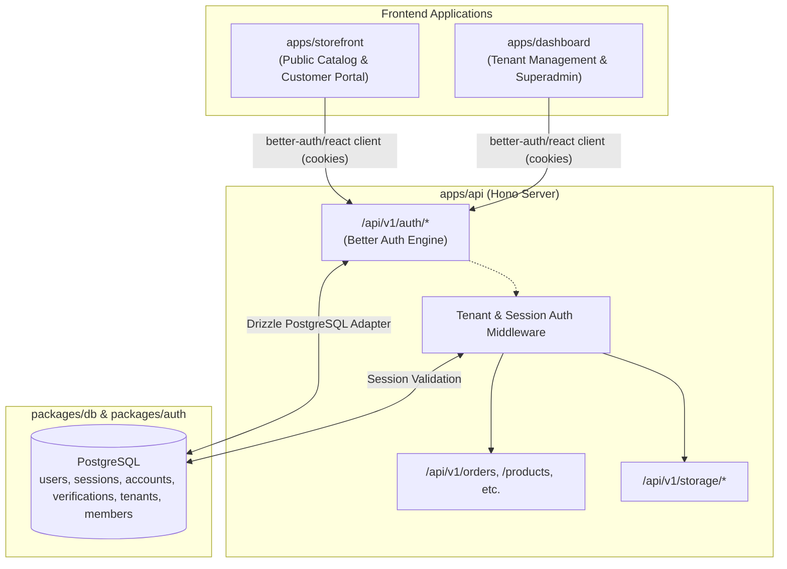

# Authentication Architecture & Multi-Tenant Session Management

This document defines the end-to-end authentication, session management, and authorization architecture across all applications in the `hono-commerce` monorepo.

---

## 1. High-Level Architecture Overview

Authentication is centralized on **Better Auth** with the **Drizzle PostgreSQL adapter**, executed inside the core backend API (`apps/api`), and consumed by the frontend applications (`apps/storefront` and `apps/dashboard`).



---

## 2. Server Configuration (`packages/auth` & `apps/api`)

### Server Engine Mount (`apps/api/src/index.ts`)

Better Auth routes are mounted natively on Hono at `/api/v1/auth/*`:

```ts
// apps/api/src/index.ts
import { auth } from "@hono-commerce/auth";

app.on(["POST", "GET"], "/api/v1/auth/*", (c) => auth.handler(c.req.raw));
```

### Server Configuration (`packages/auth/src/index.ts`)

```ts
export function createAuth() {
  const db = createDb();

  return betterAuth({
    database: drizzleAdapter(db, {
      provider: "pg",
      schema: schema,
    }),
    trustedOrigins: env.CORS_ORIGIN.split(",").map((o) => o.trim()),
    emailAndPassword: {
      enabled: true,
      requireEmailVerification: false, // Configurable per environment
    },
    secret: env.BETTER_AUTH_SECRET,
    baseURL: env.BETTER_AUTH_URL,
    advanced: {
      defaultCookieAttributes: {
        sameSite: "lax",
        secure: process.env.NODE_ENV === "production",
        httpOnly: true,
      },
    },
    plugins: [],
  });
}
```

---

## 3. Cross-Subdomain Session & Cookie Strategy

| Environment     | Hostnames                                                                                 | Cookie Scope & Attributes                                                                                                                      |
| :-------------- | :---------------------------------------------------------------------------------------- | :--------------------------------------------------------------------------------------------------------------------------------------------- |
| **Development** | `localhost:3000` (API)<br/>`localhost:3001` (Storefront)<br/>`localhost:3002` (Dashboard) | `sameSite: "none"` / `"lax"`, `credentials: "include"`, Whitelisted via `CORS_ORIGIN`.                                                         |
| **Production**  | `api.domain.com`<br/>`store.domain.com`<br/>`admin.domain.com`<br/>`[tenant].domain.com`  | `domain: ".domain.com"`, `secure: true`, `httpOnly: true`, `sameSite: "lax"`. Enables seamless **Single Sign-On (SSO)** across all subdomains. |

---

## 4. Frontend Client Integration

Both `apps/storefront` and `apps/dashboard` configure a typed Better Auth client pointing to the API auth endpoint.

### Client Initialization (`apps/*/src/lib/auth-client.ts`)

```ts
import { createAuthClient } from "better-auth/react";
import { getServerUrl } from "./server-url";

export const authClient = createAuthClient({
  baseURL: new URL(
    "/api/v1/auth",
    getServerUrl(process.env.NEXT_PUBLIC_SERVER_URL),
  ).toString(),
});

export const { useSession, signIn, signUp, signOut } = authClient;
```

---

## 5. Portal-Specific Authentication & Authorization

### A. Storefront (`apps/storefront`)

- **Public Browsing & Guest Checkout**: Catalog browsing, product reviews, cart management, and guest checkouts require no authentication.
- **Customer Portal (`/account`, `/orders`, `/chat`)**:
  - Requires customer login.
  - Allows customers to view historical order invoices, save multiple shipping addresses, and chat with tenant store support.

### B. Dashboard (`apps/dashboard`)

The dashboard is **strictly gated** with two authorization tiers:

1. **Merchant Portal (`/(tenant)`)**:
   - Manages tenant products, inventory, orders, customer messages, and settings.
   - Access verified by tenant membership: `owner`, `admin`, `member`.
   - Tenant switcher dynamically swaps active workspace context without re-authenticating.
2. **Platform Superadmin (`/(admin)`)**:
   - Manages all stores, platform-wide analytics, review moderation, and BullMQ worker queues.
   - Gated strictly by `user.role === 'admin'`.

### Server Component Route Guard (Next.js App Router)

```tsx
// apps/dashboard/src/app/(tenant)/layout.tsx
import { headers } from "next/headers";
import { redirect } from "next/navigation";
import { authClient } from "@/lib/auth-client";

export default async function TenantProtectedLayout({
  children,
}: {
  children: React.ReactNode;
}) {
  const session = await authClient.getSession({
    fetchOptions: { headers: await headers() },
  });

  if (!session?.data?.user) {
    redirect("/login");
  }

  return <>{children}</>;
}
```

---

## 6. Security & Anti-Prop-Drilling Invariants

1. **Anti-Prop-Drilling Rule**:
   - Never drill `userId`, `tenantId`, or `role` through nested component props.
   - On the server, extract `tenantId` from request headers (`extractTenantSlugFromHeaders()`) and `userId` from the verified session.
   - On the client, consume `useSession()` or workspace context.
2. **Idempotent Session Verification**:
   - Database mutations must always re-verify tenant permissions server-side inside Hono endpoints before executing queries (`where(and(eq(table.tenantId, tenantId), eq(table.id, id)))`).
3. **Short-Lived Signed URLs for KYC & Private Media**:
   - Protected user KYC files and receipts must never be served directly as public URLs. Client requests short-lived signed URLs via `/api/v1/storage/preview-url`.
