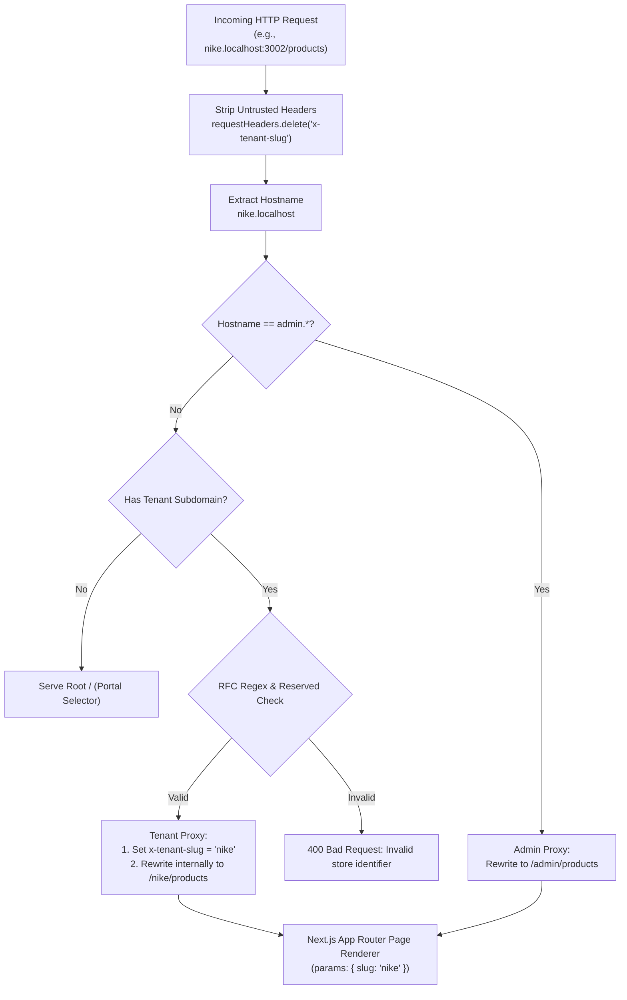
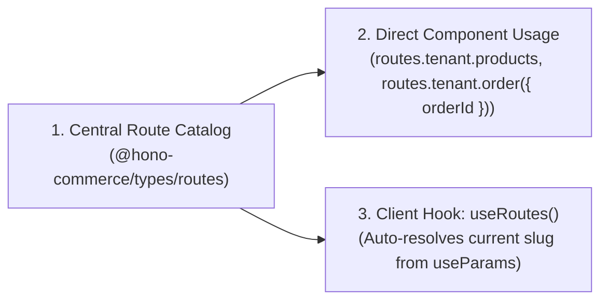

# Multi-Tenant Routing, Edge Proxy & Route Management Architecture

**Document Version**: 1.0.0  
**Status**: Approved Architecture Blueprint  
**Target Stack**: Next.js 16 (App Router), `proxy.ts` (Node.js runtime), TypeScript, RFC 6761 `*.localhost` Subdomains.

---

## 1. Executive Summary & Subdomain Invariant

In both **local development** and **production environments**, `hono-commerce` strictly enforces a **subdomain-first architecture**.

### The Subdomain Invariant

> **Visible browser URLs NEVER expose the tenant slug in the path.**
>
> - Users access store management at `[slug].localhost:3002/products` (dev) or `[slug].shop.com/products` (prod).
> - Users access superadmin management at `admin.localhost:3002/tenants` (dev) or `admin.shop.com/tenants` (prod).
> - Next.js internal file routing (`(tenant)/[slug]/...` and `(admin)/admin/...`) is completely decoupled from visible browser URLs via silent internal rewrites in `proxy.ts`.

---

## 2. Local Development Subdomain Networking (RFC 6761)

According to **[RFC 6761 (Special-Use Domain Names)](https://datatracker.ietf.org/doc/html/rfc6761)**, all modern web browsers (Chrome, Firefox, Safari, Edge) and operating systems resolve any domain ending in `.localhost` directly to loopback IP `127.0.0.1` without sending DNS queries or requiring `/etc/hosts` entries.

### Development Port Topology

| Service                  | Local Subdomain / URL            | Production URL                  | Description                              |
| :----------------------- | :------------------------------- | :------------------------------ | :--------------------------------------- |
| **API Server**           | `http://localhost:3000/api/v1/*` | `https://api.shop.com/api/v1/*` | Hono REST & Typed RPC API                |
| **Storefront**           | `http://[slug].localhost:3001/*` | `https://[slug].shop.com/*`     | Branded customer storefront              |
| **Merchant Dashboard**   | `http://[slug].localhost:3002/*` | `https://[slug].shop.com/*`     | Store management & operator portal       |
| **Superadmin Dashboard** | `http://admin.localhost:3002/*`  | `https://admin.shop.com/*`      | Platform governance, queues & moderation |
| **Portal Root**          | `http://localhost:3002/`         | `https://dashboard.shop.com/`   | Store selector / redirector              |

_Example_: Visiting `http://nike.localhost:3002/orders` in your browser works immediately out-of-the-box on port 3002.

---

## 3. Next.js 16 Edge Proxy Architecture (`proxy.ts`)

Next.js 16 deprecates `middleware.ts` in favor of **`proxy.ts`** running on the Node.js runtime.

### Processing Pipeline



### Security & Invariants

1. **Header Injection Prevention**: The proxy strips any incoming client `x-tenant-slug` header before processing to prevent malicious header spoofing.
2. **Strict Regex Validation**: Subdomain labels must match `/^[a-z0-9](?:[a-z0-9-]{0,61}[a-z0-9])?$/`.
3. **Reserved Subdomains**: Subdomains such as `admin`, `api`, `auth`, `www`, `app`, `static`, `assets`, `cdn`, and `localhost` cannot be claimed by tenants.

---

## 4. Centralized & Scalable Route Management

### The Problem

Hardcoded URL strings (e.g. `` `/products` ``, `` `/${slug}/orders/${order.id}` ``) cause:

1. **Broken Links**: Renaming a route breaks unlinked strings without TypeScript errors.
2. **Prop Drilling**: Passing `slug` down component trees just to build links.
3. **Environment Discrepancies**: Inconsistent absolute URL generation for emails and webhooks.

### The Solution: Direct & Scalable Route Catalog



#### Layer 1: Single Source of Truth (`@hono-commerce/types/routes`)

Defined in `packages/types/src/routes/catalog.ts`:

- **Static routes** are simple string constants:
  - `routes.tenant.products` (`"/products"`)
  - `routes.tenant.orders` (`"/orders"`)
  - `routes.admin.tenants` (`"/tenants"`)
- **Parameterized routes** are lightweight functions accepting typed parameter objects:
  - `routes.tenant.order({ orderId: string })` (`/orders/${orderId}`)
  - `routes.tenant.product({ productId: string })` (`/products/${productId}`)
  - `routes.admin.tenant({ tenantId: string })` (`/tenants/${tenantId}`)
  - `routes.storefront.product({ handle: string })` (`/products/${handle}`)

#### Layer 2: Natural Type Inference & Zero Assertions

Components consume routes directly with natural TypeScript inference — **no type assertions (`as Route`) and no `any`**:

```tsx
import { routes } from "@/lib/routes";
import Link from "next/link";

export function Sidebar() {
  return (
    <nav>
      {/* Parameterless routes are simple string properties */}
      <Link href={routes.tenant.products}>Products</Link>
      <Link href={routes.tenant.orders}>Orders</Link>
    </nav>
  );
}

export function OrderRow({ order }: { order: { id: string } }) {
  return (
    {/* Parameterized routes accept strongly-typed objects */}
    <Link href={routes.tenant.order({ orderId: order.id })}>
      View Order
    </Link>
  );
}
```

#### Layer 3: Centralized Subdomain Resolution (`useRoutes` & `toSubdomainUrl`)

When client components need the active tenant context without prop-drilling:

```tsx
"use client";

import { useRoutes } from "@/lib/routes";

export function StoreHeader() {
  const { slug, routes } = useRoutes();
  return <div>Store: {slug}</div>;
}
```

For cross-subdomain navigation (e.g. portal selector linking to store dashboard):

```ts
import { routes, toSubdomainUrl } from "@/lib/routes";

const storeUrl = toSubdomainUrl("default", routes.tenant.products);
// Local development: "http://default.localhost:3002/products"
// Production:        "https://default.shop.com/products"
```

---

## 5. Summary of Conventions for AI Agents & Developers

1. **Always develop using subdomains**:
   - Open `http://nike.localhost:3002` for store features.
   - Open `http://admin.localhost:3002` for superadmin features.
2. **Never hardcode string paths in UI components**:
   - Use `routes.tenant.*` or `routes.admin.*` from `@/lib/routes`.
   - Never write type assertions (`as Route` or `as any`). Let TypeScript infer types naturally.
3. **Never expose `/[slug]` in visible browser URLs**:
   - `proxy.ts` silently handles internal folder routing. Visible URLs must remain `/products`, `/orders`, etc.
