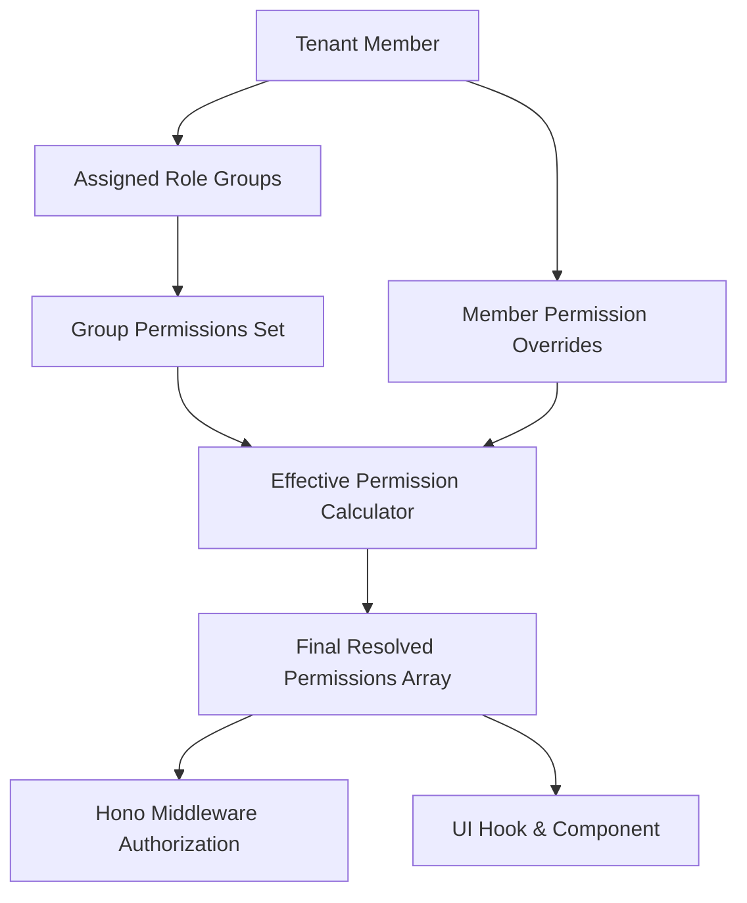
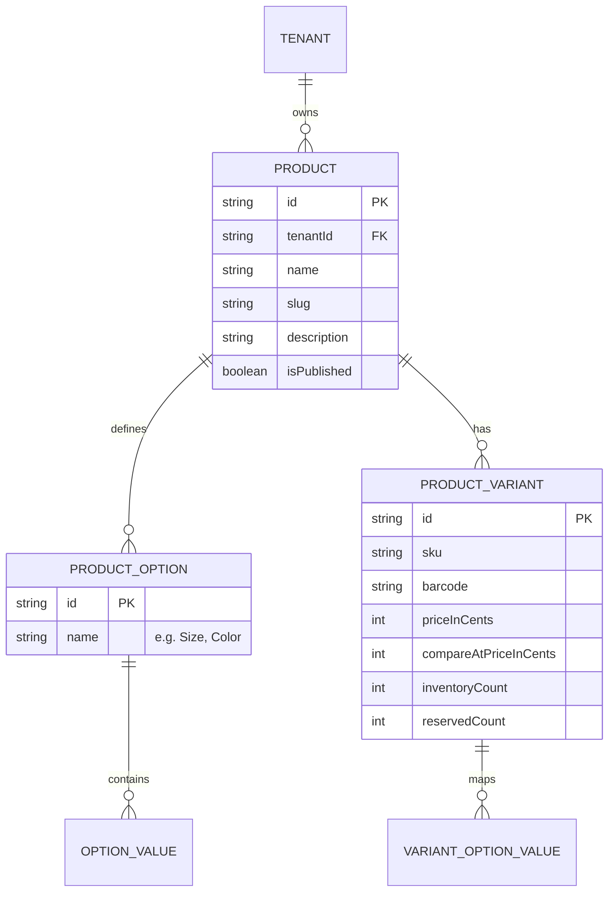
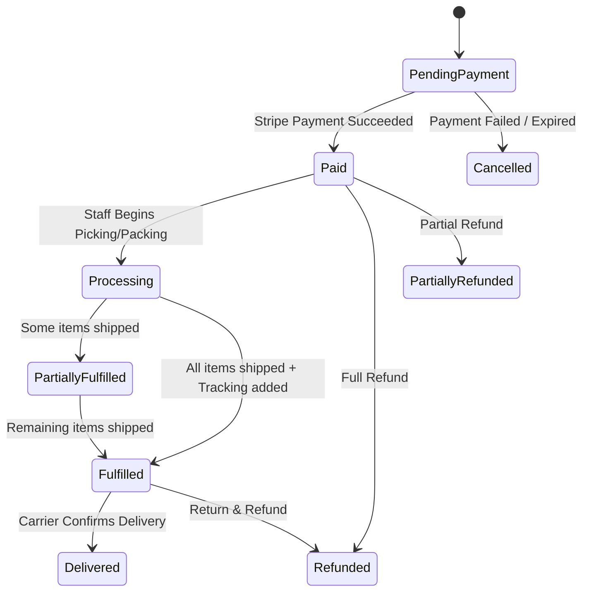
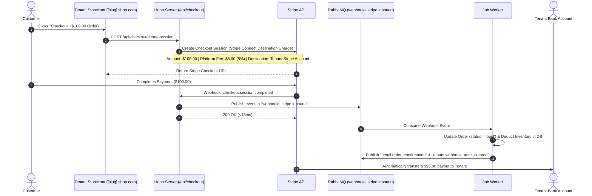
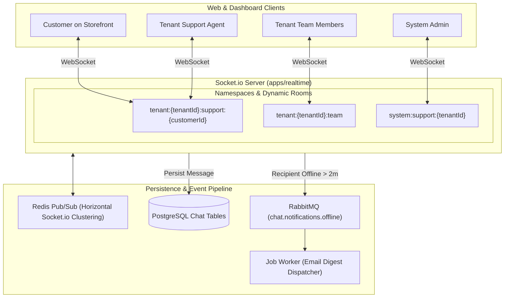
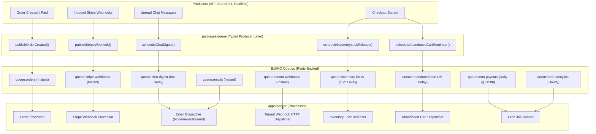

# Multi-Tenant E-Commerce SaaS Platform Architecture

**Document Version**: 1.0.0  
**Status**: Approved Architecture Blueprint  
**Target Stack**: Next.js 16 (App Router), Hono, Bun, TypeScript, PostgreSQL (Drizzle ORM), Better Auth, Stripe Connect & Billing, Socket.io (Redis Adapter), BullMQ (Redis Queues, Delayed Jobs, Crons, Bull-Board UI).

---

## 1. Executive Summary & Platform Overview

`hono-commerce` is an enterprise-grade, multi-tenant e-commerce Software-as-a-Service (SaaS) platform designed for multi-vendor marketplaces and independent brand storefronts.

### Core Capabilities

- **Multi-Tenant Subdomain & Custom Domain Routing**: Independent branded storefronts at `[slug].shop.com` and custom CNAME domains (`store.example.com`).
- **Multi-Tiered Portals**:
  - **Public Storefront (`apps/storefront`)**: Discovery, product catalog, variant selection, cart, checkout, reviews, and customer-to-vendor live chat.
  - **Tenant Management Portal (`apps/dashboard/(tenant)`)**: Catalog & inventory management, order processing, customer support, team chat, dynamic RBAC configuration, Stripe Connect payouts.
  - **System Admin Portal (`apps/dashboard/(admin)`)**: Platform-wide tenant moderation, platform fee controls, superadmin RBAC, system-to-tenant support escalation.
- **Granular Dynamic RBAC**: Extensible $4+$ segment permission keys (`NAMESPACE:MODULE:RESOURCE:ACTION`) with role group templates and member-specific overrides.
- **Unified Payment Processing (100% Stripe)**:
  - **Stripe Connect**: Automated tenant KYC onboarding, split payments, and direct/destination payouts with custom platform commissions.
  - **Stripe Billing**: Tiered recurring subscriptions for tenants paying the platform (Free, Pro, Enterprise).
- **Real-Time Communication**: Multi-channel Socket.io server with Redis Pub/Sub clustering and debounced offline email notifications.
- **Asynchronous Event-Driven Pipeline**: High-performance BullMQ message bus powered by Redis with automated exponential backoff retries, delayed lifecycle jobs, recurring crons, and Bull-Board observability, encapsulated behind a pluggable `packages/queue` abstraction layer.

---

## 2. System Topology & Monorepo Structure

```
hono-commerce/
├── apps/
│   ├── storefront/              # Public Storefront & Customer Portal (Next.js 16)
│   │                            # - Multi-tenant routing: [slug].shop.com & custom domains
│   │                            # - Product discovery, Cart, Checkout, Reviews, Support Chat
│   ├── dashboard/               # Unified Management Portal (Next.js 16)
│   │                            # - /(tenant) Store, Order & Team Management, Internal Chat
│   │                            # - /(admin) Platform Superadmin, Moderation, Bull-Board, System Chat
│   ├── api/                     # Core Backend API (Hono + Bun)
│   │                            # - Hono REST & Typed RPC (hc), Webhooks (Stripe Inbound), Auth handlers
│   ├── realtime/                # Dedicated WebSocket Server (Socket.io + Redis Adapter)
│   │                            # - Customer Support, Tenant Team, and System Admin rooms
│   └── worker/                  # Background Job Consumer (BullMQ + Redis)
│                                # - Order fulfillment, emails, webhooks, inventory locks, crons
│
├── packages/
│   ├── auth/                    # Better Auth (Organization plugin + custom RBAC permissions)
│   ├── db/                      # PostgreSQL + Drizzle ORM schemas and migration scripts
│   ├── ui/                      # Shared UI component library (shadcn/ui + Tailwind v4)
│   ├── notification/            # Email templates (React Email / Nodemailer), push notifications
│   ├── queue/                   # Pluggable Queue Manager, BullMQ definitions, typed event publishers
│   ├── types/                   # Shared Zod schemas, DTOs, permission catalog & domain types
│   ├── config/                  # Shared TypeScript, ESLint & Tailwind configs
│   └── env/                     # Type-safe environment variable schema validation
```

---

## 3. Multi-Tenancy & Domain Routing Architecture

```mermaid
graph TD
    UserReq[Incoming HTTP Request] --> EdgeMW[Next.js Middleware: Host Header Extraction]

    EdgeMW --> CheckDomain{Host Type?}

    CheckDomain -->|shop.com| RootStore[Serve Global Platform Marketplace / Directory]
    CheckDomain -->|{slug}.shop.com| SubdomainStore[Extract Tenant Slug]
    CheckDomain -->|customdomain.com| CustomStore[Query Redis/DB CNAME Mapping]

    CustomStore --> ResolveTenant[Resolve Tenant Slug & ID]
    SubdomainStore --> ResolveTenant

    ResolveTenant --> RewriteURL[Rewrite internally to /_tenants/[slug]/...]
    RewriteURL --> InjectHeaders[Inject Headers: x-tenant-id, x-tenant-slug]
    InjectHeaders --> AppRouter[Next.js App Router Page Renderer]
```

### Database Partitioning: Shared Database with `tenant_id`

- All tenant-scoped entities contain a foreign key `tenantId` indexed via composite indexes.
- All Hono route handlers and repository operations enforce `where(eq(table.tenantId, ctx.tenant.id))` automatically via procedural context.
- Resource identifiers such as `slug` or `sku` are scoped with compound unique constraints:
  ```ts
  uniqueIndex("product_slug_tenant_idx").on(product.tenantId, product.slug);
  ```

---

## 4. Fine-Grained Dynamic RBAC & Role Groups

### A. Extensible Permission Key Format ($4+$ Segments)

Permissions follow an extensible hierarchical format that allows nested subresources:

$$\text{NAMESPACE} : \text{MODULE} : \text{RESOURCE} [: \text{SUBRESOURCE}\dots] : \text{ACTION}$$

#### Examples:

- `WORKSPACE:PRODUCTS:ITEM:CREATE`
- `WORKSPACE:PRODUCTS:ITEM:VARIANT:UPDATE`
- `WORKSPACE:ORDERS:FULFILLMENT:TRACKING:UPDATE`
- `WORKSPACE:SETTINGS:BILLING:PAYMENT_METHOD:DELETE`
- `WORKSPACE:SETTINGS:TEAM:ROLE_GROUP:PERMISSION:OVERRIDE`
- `SYSTEM:TENANTS:SUBSCRIPTION:PLAN:CHANGE`
- `SYSTEM:MODERATION:REVIEWS:STATUS:UPDATE`

### B. Role Hierarchy & Resolution Logic

1. **Tenant Roles**:
   - **`owner`**: Immutable superuser of the tenant. Evaluated with wildcard `*` (has all permissions).
   - **`member`**: Staff/collaborators. Permissions are dynamically computed from assigned **Role Groups** plus **Member-specific Overrides**.
2. **Role Groups (Templates)**:
   - System default presets: _Store Manager_, _Support Specialist_, _Order Fulfillment_, _Catalog Editor_.
   - Tenant custom groups: Owners can create custom groups with specific subsets of permissions.
3. **Member Overrides**:
   - Owners can explicitly **grant** $(+)$ or **revoke** $(-)$ specific permissions for any individual member.



---

## 5. E-Commerce Core Subsystems & Domain Modeling

### A. Product Catalog & Variant Matrix

Products support complex option matrices (e.g. Size: S/M/L, Color: Red/Blue):



### B. Inventory Reservation & Race Condition Prevention

To prevent overselling during flash sales:

1. When a user navigates to the checkout session, an inventory reservation is created with a 15-minute expiration:
   $$\text{Available Stock} = \text{inventoryCount} - \text{reservedCount}$$
2. On payment success (`checkout.session.completed`):
   $$\text{inventoryCount} \leftarrow \text{inventoryCount} - \text{quantity}, \quad \text{reservedCount} \leftarrow \text{reservedCount} - \text{quantity}$$
3. On checkout cancellation or session expiry:
   $$\text{reservedCount} \leftarrow \text{reservedCount} - \text{quantity}$$

### C. Order Management System (OMS) State Machine



### D. Verified Buyer Reviews Engine

- **Verified Purchase Badge**: Tied to the customer's `order_item` history. Only verified buyers receive `isVerifiedPurchase = true`.
- **Moderation Flow**: Reviews transition across `published`, `pending_moderation`, or `flagged`.
- **Vendor Responses**: Tenants can submit official replies to reviews.

---

## 6. Payments Architecture (100% Stripe)



### Payment Subsystems:

1. **Stripe Connect (Storefront Orders)**:
   - Express / Custom connected accounts for each tenant store.
   - Direct or destination charges with dynamic application fees (e.g. 5% platform commission).
   - Automated tenant KYC/KYB identity verification and automated bank payouts.
2. **Stripe Billing (Tenant Platform Subscriptions)**:
   - SaaS subscription tiers for tenants (Starter $29/mo, Pro $99/mo, Enterprise $299/mo).
   - Webhook synchronization with Better Auth organization subscription metadata.

---

## 7. Real-Time Chat Subsystem (Socket.io)



### The 3 Chat Channels:

1. **`customer_support`** (`tenant:{tenantId}:support:{customerId}`): Customer-to-store inquiries. Restricted to the customer and tenant staff with `WORKSPACE:COMMUNICATION:SUPPORT_CHAT:RESPOND`.

- `customer_support` (`tenant:{tenantId}:support:{customerId}`): Customer-to-store inquiries. Restricted to the customer and tenant staff with `WORKSPACE:COMMUNICATION:SUPPORT_CHAT:RESPOND`.
- `tenant_team` (`tenant:{tenantId}:team`): Internal team collaboration room for store staff.
- `system_support` (`system:support:{tenantId}`): Dedicated channel between Tenant Owners and System Superadmins for platform assistance.

---

### 8. Asynchronous Event Processing & Queuing Architecture (BullMQ)

`hono-commerce` utilizes **BullMQ** on top of our existing **Redis** infrastructure for unified instant event queues, delayed lifecycle jobs, and recurring cron schedules.



---

### A. Queue Definitions & Job Contracts

| Queue Name        | Job Type             | Trigger & Delay                             | Purpose & Action                                                             |
| :---------------- | :------------------- | :------------------------------------------ | :--------------------------------------------------------------------------- |
| `orders`          | Instant              | On customer checkout completion             | Deducts persistent stock, sets status to `PAID`, triggers invoice email.     |
| `stripe-webhooks` | Instant              | On Stripe HTTP webhook hit ($<20\text{ms}$) | Idempotently processes `checkout.session.completed`, `account.updated`.      |
| `tenant-webhooks` | Instant              | On order state transition                   | Dispatches signed HMAC webhooks to external tenant endpoints.                |
| `emails`          | Instant              | On transactional event                      | Dispatches React Email / Nodemailer messages.                                |
| `inventory-locks` | **Delayed (15m)**    | On checkout initialization                  | Releases reserved variant stock if order is not completed within 15 minutes. |
| `abandoned-cart`  | **Delayed (2h)**     | On cart idle                                | Dispatches email drip reminder with cart restore link.                       |
| `chat-digest`     | **Delayed (5m)**     | On unread chat message                      | Debounces email notifications for offline customers/staff.                   |
| `cron-payouts`    | *_Cron (0 0 * * *)*_ | Nightly at midnight UTC                     | Reconciles Stripe Connect split transfers and platform commissions.          |
| `cron-analytics`  | *_Cron (0 * * * *)*_ | Hourly                                      | Aggregates tenant GMV, order volume, and active customer counts.             |

---

### B. Decoupled Architecture & Polyglot Future-Proofing

To ensure architectural scalability and make future integrations (e.g. Go backend microservices or RabbitMQ AMQP routing) frictionless, the system adheres to strict decoupling rules:

1. **Zero Direct BullMQ Imports in Business Logic**:
   - `apps/api`, `apps/storefront`, and `apps/dashboard` **never import BullMQ directly**.
   - All producers are imported exclusively from `@hono-commerce/queue` (`packages/queue/src/publishers/*`).
2. **Pluggable Driver Pattern**:
   - If a high-performance **Golang** service is introduced in the future:
     - **Option 1 (Redis Streams / Shared Redis)**: The Go service can consume directly from Redis without changes to the infrastructure.
     - **Option 2 (AMQP / RabbitMQ Bridge)**: Modify `packages/queue` to broadcast events to RabbitMQ without touching any API route handlers.
3. **Built-in Visual Monitoring (`@bull-board`)**:
   - The Bull-Board UI is mounted securely in `apps/dashboard/(admin)` to inspect job throughput, latency, failed jobs, and trigger manual retries.

---

## 9. Complete Database Schema Blueprint (Drizzle ORM)

```ts
import {
  pgTable,
  text,
  timestamp,
  boolean,
  integer,
  jsonb,
  uniqueIndex,
  index,
} from "drizzle-orm/pg-core";

// ==========================================
// 1. TENANTS & MULTI-TENANCY
// ==========================================
export const tenant = pgTable("tenant", {
  id: text("id").primaryKey(),
  name: text("name").notNull(),
  slug: text("slug").notNull().unique(),
  customDomain: text("custom_domain").unique(),
  stripeConnectAccountId: text("stripe_connect_account_id").unique(),
  stripeCustomerId: text("stripe_customer_id").unique(),
  stripeSubscriptionId: text("stripe_subscription_id"),
  subscriptionPlan: text("subscription_plan").default("starter").notNull(),
  isActive: boolean("is_active").default(true).notNull(),
  createdAt: timestamp("created_at").defaultNow().notNull(),
  updatedAt: timestamp("updated_at").defaultNow().notNull(),
});

// ==========================================
// 2. TENANT MEMBERS & RBAC
// ==========================================
export const tenantMember = pgTable(
  "tenant_member",
  {
    id: text("id").primaryKey(),
    tenantId: text("tenant_id")
      .notNull()
      .references(() => tenant.id, { onDelete: "cascade" }),
    userId: text("user_id").notNull(),
    role: text("role", { enum: ["owner", "member"] })
      .default("member")
      .notNull(),
    createdAt: timestamp("created_at").defaultNow().notNull(),
  },
  (table) => [uniqueIndex("tenant_user_idx").on(table.tenantId, table.userId)],
);

export const tenantRoleGroup = pgTable("tenant_role_group", {
  id: text("id").primaryKey(),
  tenantId: text("tenant_id").references(() => tenant.id, {
    onDelete: "cascade",
  }), // null = system default
  name: text("name").notNull(),
  description: text("description"),
  isDefault: boolean("is_default").default(false).notNull(),
});

export const roleGroupPermission = pgTable(
  "role_group_permission",
  {
    id: text("id").primaryKey(),
    roleGroupId: text("role_group_id")
      .notNull()
      .references(() => tenantRoleGroup.id, { onDelete: "cascade" }),
    permission: text("permission").notNull(),
  },
  (table) => [
    uniqueIndex("role_group_perm_idx").on(table.roleGroupId, table.permission),
  ],
);

export const memberRoleGroup = pgTable(
  "member_role_group",
  {
    id: text("id").primaryKey(),
    memberId: text("member_id")
      .notNull()
      .references(() => tenantMember.id, { onDelete: "cascade" }),
    roleGroupId: text("role_group_id")
      .notNull()
      .references(() => tenantRoleGroup.id, { onDelete: "cascade" }),
  },
  (table) => [
    uniqueIndex("member_role_group_idx").on(table.memberId, table.roleGroupId),
  ],
);

export const memberPermissionOverride = pgTable(
  "member_permission_override",
  {
    id: text("id").primaryKey(),
    memberId: text("member_id")
      .notNull()
      .references(() => tenantMember.id, { onDelete: "cascade" }),
    permission: text("permission").notNull(),
    isGranted: boolean("is_granted").notNull(),
  },
  (table) => [
    uniqueIndex("member_override_perm_idx").on(
      table.memberId,
      table.permission,
    ),
  ],
);

// ==========================================
// 3. CATALOG & PRODUCTS
// ==========================================
export const product = pgTable(
  "product",
  {
    id: text("id").primaryKey(),
    tenantId: text("tenant_id")
      .notNull()
      .references(() => tenant.id, { onDelete: "cascade" }),
    name: text("name").notNull(),
    slug: text("slug").notNull(),
    description: text("description"),
    isPublished: boolean("is_published").default(true).notNull(),
    createdAt: timestamp("created_at").defaultNow().notNull(),
    updatedAt: timestamp("updated_at").defaultNow().notNull(),
  },
  (table) => [
    uniqueIndex("tenant_product_slug_idx").on(table.tenantId, table.slug),
  ],
);

export const productVariant = pgTable(
  "product_variant",
  {
    id: text("id").primaryKey(),
    productId: text("product_id")
      .notNull()
      .references(() => product.id, { onDelete: "cascade" }),
    sku: text("sku").notNull(),
    barcode: text("barcode"),
    priceInCents: integer("price_in_cents").notNull(),
    compareAtPriceInCents: integer("compare_at_price_in_cents"),
    inventoryCount: integer("inventory_count").default(0).notNull(),
    reservedCount: integer("reserved_count").default(0).notNull(),
    options: jsonb("options").$type<Record<string, string>>().notNull(), // e.g. { "size": "L", "color": "Red" }
  },
  (table) => [uniqueIndex("variant_sku_idx").on(table.sku)],
);

// ==========================================
// 4. ORDERS & CHECKOUT
// ==========================================
export const order = pgTable(
  "order",
  {
    id: text("id").primaryKey(),
    tenantId: text("tenant_id")
      .notNull()
      .references(() => tenant.id, { onDelete: "cascade" }),
    customerId: text("customer_id"),
    customerEmail: text("customer_email").notNull(),
    stripeSessionId: text("stripe_session_id").unique(),
    stripePaymentIntentId: text("stripe_payment_intent_id").unique(),
    status: text("status", {
      enum: [
        "pending_payment",
        "paid",
        "processing",
        "fulfilled",
        "delivered",
        "refunded",
        "cancelled",
      ],
    })
      .default("pending_payment")
      .notNull(),
    totalAmountInCents: integer("total_amount_in_cents").notNull(),
    platformFeeInCents: integer("platform_fee_in_cents").notNull(),
    currency: text("currency").default("USD").notNull(),
    shippingAddress: jsonb("shipping_address"),
    createdAt: timestamp("created_at").defaultNow().notNull(),
    updatedAt: timestamp("updated_at").defaultNow().notNull(),
  },
  (table) => [index("order_tenant_idx").on(table.tenantId)],
);

export const orderItem = pgTable("order_item", {
  id: text("id").primaryKey(),
  orderId: text("order_id")
    .notNull()
    .references(() => order.id, { onDelete: "cascade" }),
  variantId: text("variant_id")
    .notNull()
    .references(() => productVariant.id),
  quantity: integer("quantity").notNull(),
  unitPriceInCents: integer("unit_price_in_cents").notNull(),
});

// ==========================================
// 5. REVIEWS & RATINGS
// ==========================================
export const review = pgTable("review", {
  id: text("id").primaryKey(),
  tenantId: text("tenant_id")
    .notNull()
    .references(() => tenant.id, { onDelete: "cascade" }),
  productId: text("product_id")
    .notNull()
    .references(() => product.id, { onDelete: "cascade" }),
  customerId: text("customer_id").notNull(),
  orderItemId: text("order_item_id").references(() => orderItem.id),
  rating: integer("rating").notNull(), // 1 - 5
  title: text("title"),
  content: text("content").notNull(),
  isVerifiedPurchase: boolean("is_verified_purchase").default(false).notNull(),
  status: text("status", {
    enum: ["published", "pending_moderation", "flagged"],
  })
    .default("published")
    .notNull(),
  vendorReply: text("vendor_reply"),
  vendorRepliedAt: timestamp("vendor_replied_at"),
  createdAt: timestamp("created_at").defaultNow().notNull(),
});

// ==========================================
// 6. REAL-TIME CHAT & MESSAGING
// ==========================================
export const chatRoom = pgTable("chat_room", {
  id: text("id").primaryKey(),
  tenantId: text("tenant_id")
    .notNull()
    .references(() => tenant.id, { onDelete: "cascade" }),
  type: text("type", {
    enum: ["customer_support", "tenant_team", "system_support"],
  }).notNull(),
  customerId: text("customer_id"), // set for customer_support
  title: text("title"),
  createdAt: timestamp("created_at").defaultNow().notNull(),
});

export const chatMessage = pgTable(
  "chat_message",
  {
    id: text("id").primaryKey(),
    roomId: text("room_id")
      .notNull()
      .references(() => chatRoom.id, { onDelete: "cascade" }),
    senderId: text("sender_id").notNull(),
    senderType: text("sender_type", {
      enum: ["customer", "tenant_member", "system_admin"],
    }).notNull(),
    content: text("content").notNull(),
    attachments:
      jsonb("attachments").$type<
        Array<{ url: string; name: string; size: number }>
      >(),
    readAt: timestamp("read_at"),
    createdAt: timestamp("created_at").defaultNow().notNull(),
  },
  (table) => [index("chat_message_room_idx").on(table.roomId, table.createdAt)],
);
```

---

## 10. Implementation Phases & Milestones

| Phase                                 | Core Objective              | Key Deliverables                                                                                                                                  |
| :------------------------------------ | :-------------------------- | :------------------------------------------------------------------------------------------------------------------------------------------------ |
| **Phase 1: Foundation & DB Schemas**  | Database & Shared Packages  | Drizzle schema migrations (`tenants`, `rbac`, `products`, `orders`, `chat`), `packages/types` permission registry, `packages/queue` BullMQ setup. |
| **Phase 2: Multi-Tenant Storefront**  | Subdomain & Cart Experience | Next.js middleware subdomain resolver, product catalog, variant selectors, cart, Stripe Connect destination checkout.                             |
| **Phase 3: RBAC & Dashboard**         | Tenant & Admin Portals      | `apps/dashboard` with `/(tenant)` and `/(admin)` route groups, Role Group builder UI, Hono permission middleware.                                 |
| **Phase 4: BullMQ & Background Jobs** | Async Processing Pipeline   | `apps/worker`, BullMQ processors, Stripe webhook consumer, transactional emails, delayed cart recovery, Bull-Board admin UI.                      |
| **Phase 5: Real-Time Chat**           | Live Communication Engine   | `apps/realtime` (Socket.io + Redis Pub/Sub), Customer Support widget, Tenant Team room, Admin escalation channel.                                 |
| **Phase 6: Reviews & Moderation**     | Feedback & Quality Control  | Verified buyer review submission, tenant owner response UI, admin review moderation.                                                              |
