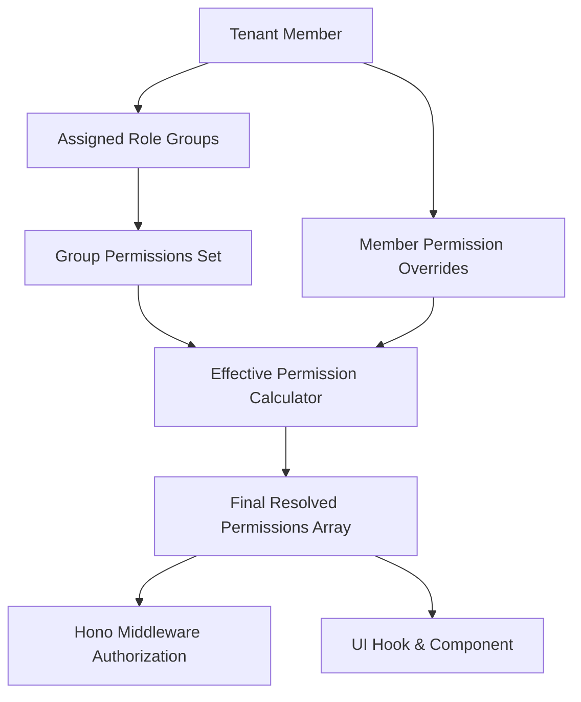
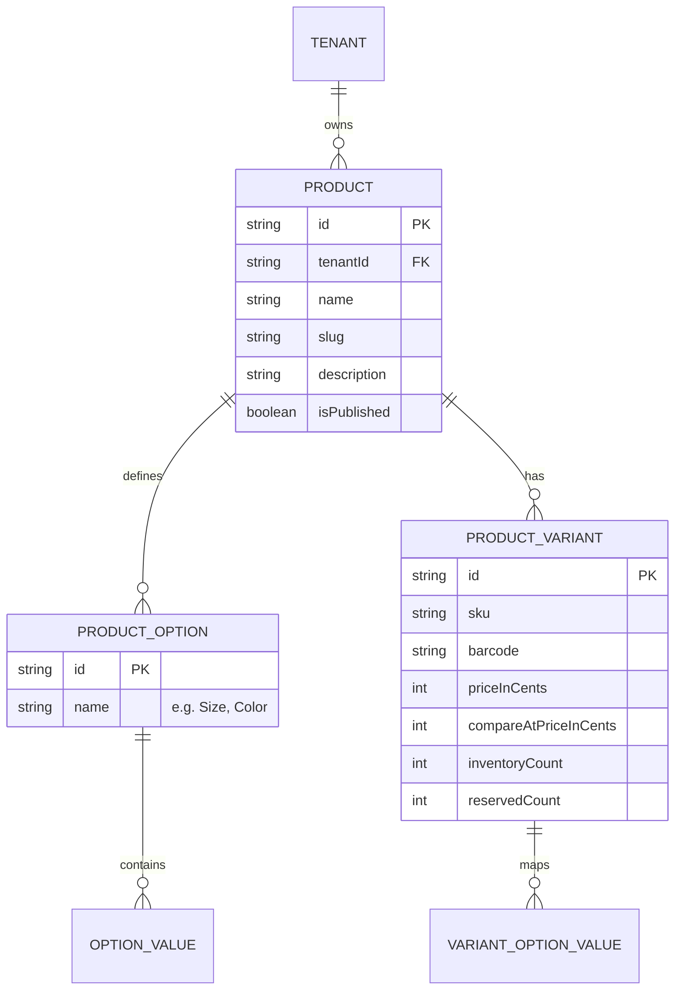
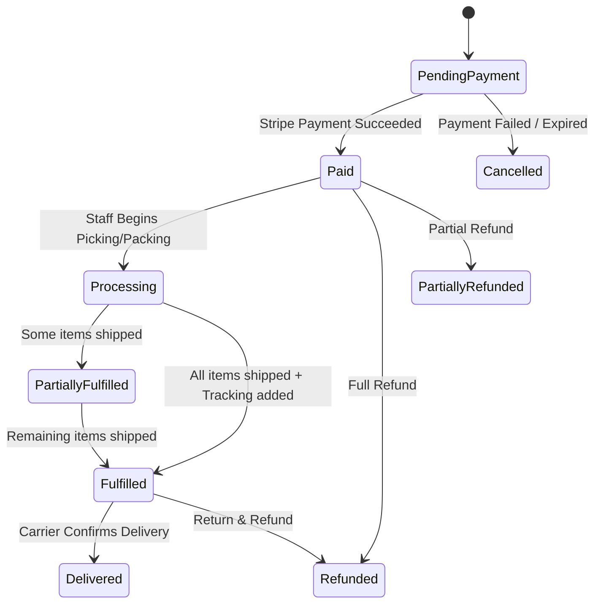
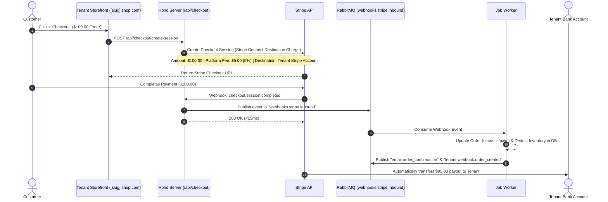
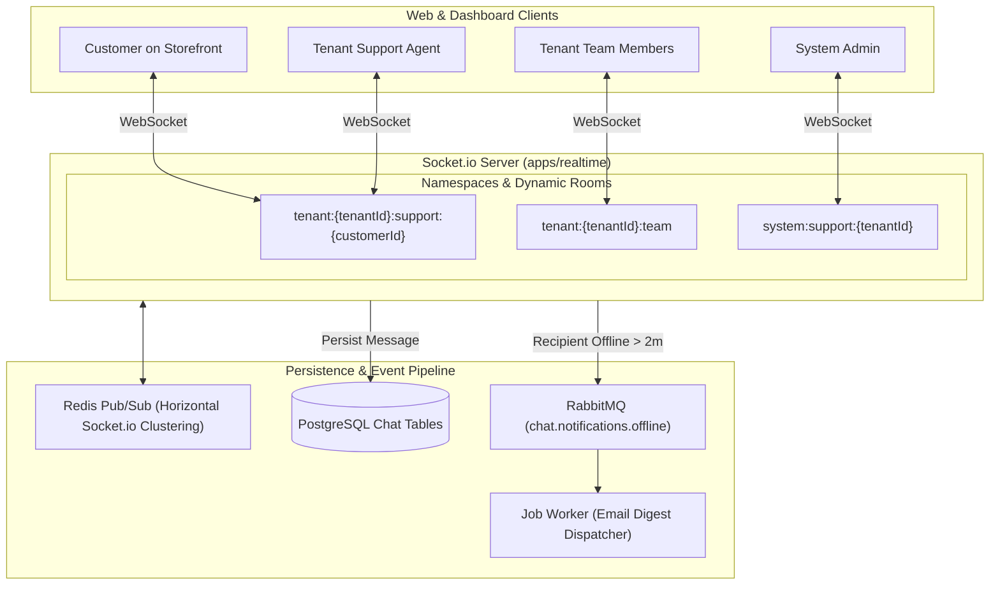
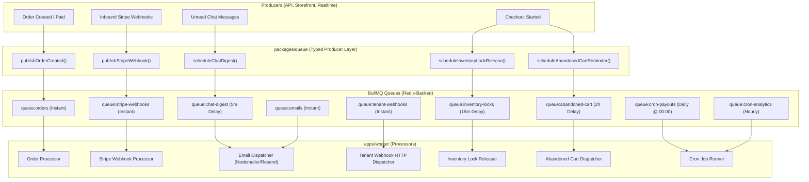
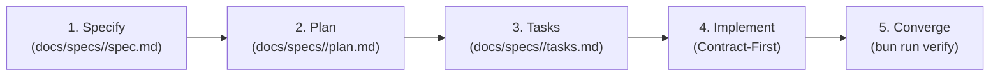

# Multi-Tenant E-Commerce SaaS Platform Architecture

**Document Version**: 1.0.0  
**Status**: Approved Architecture Blueprint  
**Target Stack**: Next.js 16 (App Router), Hono, Bun, TypeScript, PostgreSQL (Drizzle ORM), Better Auth, Stripe Connect & Billing, Socket.io (Redis Adapter), BullMQ (Redis Queues, Delayed Jobs, Crons, Bull-Board UI).

---

## 1. Executive Summary & Platform Overview

`hono-commerce` is an enterprise-grade, multi-tenant e-commerce Software-as-a-Service (SaaS) platform designed for multi-vendor marketplaces and independent brand storefronts.

### Core Capabilities

- **Multi-Tenant Subdomain & Custom Domain Routing**: Independent branded storefronts at `[slug].shop.com` and custom CNAME domains (`store.example.com`).
- **Multi-Tiered Portals**:
  - **Public Storefront (`apps/storefront`)**: Discovery, product catalog, variant selection, cart, checkout, reviews, and customer-to-vendor live chat.
  - **Tenant Management Portal (`apps/dashboard/(tenant)`)**: Catalog & inventory management, order processing, customer support, team chat, dynamic RBAC configuration, Stripe Connect payouts.
  - **System Admin Portal (`apps/dashboard/(admin)`)**: Platform-wide tenant moderation, platform fee controls, superadmin RBAC, system-to-tenant support escalation.
- **Granular Dynamic RBAC**: Extensible $4+$ segment permission keys (`NAMESPACE:MODULE:RESOURCE:ACTION`) with role group templates and member-specific overrides.
- **Unified Payment Processing (100% Stripe)**:
  - **Stripe Connect**: Automated tenant KYC onboarding, split payments, and direct/destination payouts with custom platform commissions.
  - **Stripe Billing**: Tiered recurring subscriptions for tenants paying the platform (Free, Pro, Enterprise).
- **Real-Time Communication**: Multi-channel Socket.io server with Redis Pub/Sub clustering and debounced offline email notifications.
- **Asynchronous Event-Driven Pipeline**: High-performance BullMQ message bus powered by Redis with automated exponential backoff retries, delayed lifecycle jobs, recurring crons, and Bull-Board observability, encapsulated behind a pluggable `packages/queue` abstraction layer.

---

## 2. System Topology & Monorepo Structure

```
hono-commerce/
├── apps/
│   ├── storefront/              # Public Storefront & Customer Portal (Next.js 16)
│   │                            # - Multi-tenant routing: [slug].shop.com & custom domains
│   │                            # - Product discovery, Cart, Checkout, Reviews, Support Chat
│   ├── dashboard/               # Unified Management Portal (Next.js 16)
│   │                            # - /(tenant) Store, Order & Team Management, Internal Chat
│   │                            # - /(admin) Platform Superadmin, Moderation, Bull-Board, System Chat
│   │                            # - /(public) Public Auth, Verification & Invitation Acceptance
│   ├── api/                     # Core Backend API (Hono + Bun)

│   │                            # - Hono REST & Typed RPC (hc), Webhooks (Stripe Inbound), Auth handlers
│   ├── realtime/                # Dedicated WebSocket Server (Socket.io + Redis Adapter)
│   │                            # - Customer Support, Tenant Team, and System Admin rooms
│   └── worker/                  # Background Job Consumer (BullMQ + Redis)
│                                # - Order fulfillment, emails, webhooks, inventory locks, crons
│
├── packages/
│   ├── auth/                    # Better Auth (Session & Auth engine + custom multi-tenant & RBAC permissions)
│   ├── db/                      # PostgreSQL + Drizzle ORM schemas and migration scripts
│   ├── ui/                      # Shared UI component library (shadcn/ui + Tailwind v4)
│   ├── notification/            # Email templates (React Email / Nodemailer), push notifications
│   ├── queue/                   # Pluggable Queue Manager, BullMQ definitions, typed event publishers
│   ├── types/                   # Shared Zod request schemas, route catalog & domain types
│   ├── config/                  # Shared TypeScript, ESLint & Tailwind configs
│   └── env/                     # Type-safe environment variable schema validation
│
└── docs/
    ├── architecture/            # Architectural blueprints & ADR registry (README.md)
    └── specs/                   # Living feature specifications (Spec-Driven Development)
        └── _template/           # spec.md, plan.md, tasks.md templates
```

---

## 3. Multi-Tenancy & Domain Routing Architecture

### Frontend View State Contract

Next.js applications use `nuqs` for shareable, URL-addressable view state (filters, search, date ranges, pagination, sorting, tabs, selected resources, and shareable drawer/split-view state). Each app mounts one `NuqsAdapter`. Parsed values are normalized and included in TanStack Query keys before being mapped to typed Hono RPC query parameters; TanStack Query remains the owner of server data and request status. Transient interaction state and unsaved React Hook Form drafts remain local. Server components use the same typed parser definitions through `nuqs/server` `createSearchParamsCache`, while API Zod schemas remain authoritative for validation and bounds.

In Next.js 16, edge domain routing and security filtering are executed via **`proxy.ts`** on the Node.js runtime:

```mermaid
graph TD
    UserReq[Incoming HTTP Request] --> Proxy[Next.js 16 proxy.ts: Host Header Extraction]
    Proxy --> StripSpoof[Strip untrusted client x-tenant-slug header]
    StripSpoof --> CheckDomain{Host Type?}

    CheckDomain -->|admin.shop.com| AdminDomain[Internal Rewrite to /admin/*]
    CheckDomain -->|{slug}.shop.com| TenantDomain[Validate RFC Slug Regex]
    CheckDomain -->|customdomain.com| CustomStore[Query Redis/DB CNAME Mapping]
    CheckDomain -->|shop.com| RootStore[Serve Portal Selector / Directory]

    CustomStore --> ResolveTenant[Resolve Tenant Slug]
    TenantDomain --> ResolveTenant
    ResolveTenant --> RewriteURL[Rewrite internally to /[slug]/*]
    RewriteURL --> InjectHeaders[Inject verified Header: x-tenant-slug]
    InjectHeaders --> AppRouter[Next.js App Router Page Renderer]
    AdminDomain --> AppRouter
```

### Next.js 16 Folder Structure & Subdomain Invariant

- **Local Dev & Production Parity**: Subdomains are strictly enforced in both development (`[slug].localhost:3002`, `admin.localhost:3002` via RFC 6761) and production (`[slug].shop.com`, `admin.shop.com`).
- **Superadmin Portal**: `apps/dashboard/src/app/(admin)/admin/` (Accessible via `admin.localhost:3002/*` or `admin.shop.com/*` rewritten silently to `/admin/*`). Visible URLs remain `/tenants`, `/moderation`, etc.
- **Tenant Portal**: `apps/dashboard/src/app/(tenant)/[slug]/` (Accessible via `[slug].localhost:3002/*` or `[slug].shop.com/*` rewritten silently to `/[slug]/*`). Visible URLs remain `/products`, `/orders`, etc.
- **Storefront**: `apps/storefront/src/app/` (Resolves tenant from subdomain `[slug].localhost:3001` or custom CNAME, verified via `proxy.ts`).

### Database Partitioning: Shared Database with `tenant_id`

- All tenant-scoped entities contain a foreign key `tenantId` indexed via composite indexes.
- All Hono route handlers and repository operations enforce `where(eq(table.tenantId, ctx.tenant.id))` automatically via procedural context.
- Resource identifiers such as `slug` or `sku` are scoped with compound unique constraints:
  ```ts
  uniqueIndex("product_slug_tenant_idx").on(product.tenantId, product.slug);
  ```

---

## 4. Fine-Grained Dynamic RBAC & Role Groups

### A. Extensible Permission Key Format ($4+$ Segments)

Permissions follow an extensible hierarchical format that allows nested subresources:

$$\text{NAMESPACE} : \text{MODULE} : \text{RESOURCE} [: \text{SUBRESOURCE}\dots] : \text{ACTION}$$

#### Examples:

- `WORKSPACE:PRODUCTS:ITEM:CREATE`
- `WORKSPACE:PRODUCTS:ITEM:VARIANT:UPDATE`
- `WORKSPACE:ORDERS:FULFILLMENT:TRACKING:UPDATE`
- `WORKSPACE:SETTINGS:BILLING:PAYMENT_METHOD:DELETE`
- `WORKSPACE:SETTINGS:TEAM:ROLE_GROUP:PERMISSION:OVERRIDE`
- `SYSTEM:TENANTS:SUBSCRIPTION:PLAN:CHANGE`
- `SYSTEM:MODERATION:REVIEWS:STATUS:UPDATE`

### B. Role Hierarchy & Resolution Logic

1. **Tenant Roles**:
   - **`owner`**: Immutable superuser of the tenant. Evaluated with wildcard `*` (has all permissions).
   - **`member`**: Staff/collaborators. Permissions are dynamically computed from assigned **Role Groups** plus **Member-specific Overrides**.
2. **Role Groups (Templates)**:
   - System default presets: _Store Manager_, _Support Specialist_, _Order Fulfillment_, _Catalog Editor_.
   - Tenant custom groups: Owners can create custom groups with specific subsets of permissions.
3. **Member Overrides**:
   - Owners can explicitly **grant** $(+)$ or **revoke** $(-)$ specific permissions for any individual member.



### C. Account Lifecycle & Structured `TenantContext` Authorization

1. **Platform & Merchant Role Taxonomy**:
   - **Platform Roles**: `admin` (superadmin), `staff` (support/operations), `customer` (storefront shopper).
   - **Merchant Roles**: `owner` (store creator, billing, payouts), `member` (store staff, catalog, orders).
2. **Account Lifecycle Enforcement (`requireAuth`)**:
   - Users must have `user.status === "active"` and `!user.banned`. Suspended or deactivated users are rejected with `403 FORBIDDEN` (`ACCOUNT_SUSPENDED`).
3. **Structured `TenantContext` Resolution (`requireTenantContext`)**:
   - The tenant is resolved server-side from the URL `/api/v1/tenants/:tenantId/...`, NEVER trusting a client session's stale `activeTenantId` as authorization.
   - The user must possess an active membership (`tenantMember.status === "active"`) in the target tenant.
   - The resolved context attaches to Hono's typed context:
     ```ts
     type TenantContext = {
       tenantId: string;
       tenantSlug: string;
       tenantStatus: "active" | "suspended" | "maintenance";
       memberId: string;
       role: "owner" | "member";
     };
     ```
4. **Declarative Permission Gating (`requirePermission`)**:
   - Compares requested permissions against the caller's role permissions (`hasPermission(role, permission)`).

### D. Invitation Cryptographic Security & 2-Step Onboarding

1. **Cryptographic JWT Claims & Single-Use Tokens**:
   - Invitations issue HS256-signed JWTs (`jose`) binding `invitationId`, `tenantId`, `email`, and `role`.
   - On resolution (`GET /api/v1/invitations/:invitationId?token=...`), the JWT claims are cross-checked against the database record to prevent token reuse or tampering.
2. **Authenticated Acceptance & Inbox Ownership Verification**:
   - Invitation acceptance (`PATCH /api/v1/invitations/:invitationId`) strictly requires an authenticated session matching the invitation's canonical email.
   - Accepting an invitation automatically verifies email ownership via magic link prior to acceptance.
3. **Atomic Status Transition & Membership Provisioning**:
   - Status update (`accepted`) and `tenant_member` record creation are executed inside an atomic PostgreSQL `db.transaction(...)` with conditional locking, ensuring no partial state on failure.
4. **2-Step Sliding Sign-In / Sign-Up Flow**:
   - Step 1: User enters email. Frontend queries `POST /api/v1/auth/check-email`.
   - Existing User: Direct magic link request dispatched.
   - New User: Smooth sliding card transition to Step 2 requesting user's full name, creating the account, and sending the magic link.
   - On magic link verification (`/verify`), user is redirected seamlessly back to the pending invitation URL.

---

## 5. E-Commerce Core Subsystems & Domain Modeling

### A. Product Catalog & Variant Matrix

Products support complex option matrices (e.g. Size: S/M/L, Color: Red/Blue):



### B. Inventory Reservation & Race Condition Prevention

To prevent overselling during flash sales:

1. When a user navigates to the checkout session, an inventory reservation is created with a 15-minute expiration:
   $$\text{Available Stock} = \text{inventoryCount} - \text{reservedCount}$$
2. On payment success (`checkout.session.completed`):
   $$\text{inventoryCount} \leftarrow \text{inventoryCount} - \text{quantity}, \quad \text{reservedCount} \leftarrow \text{reservedCount} - \text{quantity}$$
3. On checkout cancellation or session expiry:
   $$\text{reservedCount} \leftarrow \text{reservedCount} - \text{quantity}$$

### C. Order Management System (OMS) State Machine



### D. Verified Buyer Reviews Engine

- **Verified Purchase Badge**: Tied to the customer's `order_item` history. Only verified buyers receive `isVerifiedPurchase = true`.
- **Moderation Flow**: Reviews transition across `published`, `pending_moderation`, or `flagged`.
- **Vendor Responses**: Tenants can submit official replies to reviews.

---

## 6. Payments Architecture (100% Stripe)



### Payment Subsystems:

1. **Stripe Connect (Storefront Orders)**:
   - Express / Custom connected accounts for each tenant store.
   - Direct or destination charges with dynamic application fees (e.g. 5% platform commission).
   - Automated tenant KYC/KYB identity verification and automated bank payouts.
2. **Stripe Billing (Tenant Platform Subscriptions)**:
   - SaaS subscription tiers for tenants (Starter $29/mo, Pro $99/mo, Enterprise $299/mo).
   - Webhook synchronization with tenant subscription metadata.

---

## 7. Real-Time Chat Subsystem (Socket.io)



### The 3 Chat Channels:

1. **`customer_support`** (`tenant:{tenantId}:support:{customerId}`): Customer-to-store inquiries. Restricted to the customer and tenant staff with `WORKSPACE:COMMUNICATION:SUPPORT_CHAT:RESPOND`.

- `customer_support` (`tenant:{tenantId}:support:{customerId}`): Customer-to-store inquiries. Restricted to the customer and tenant staff with `WORKSPACE:COMMUNICATION:SUPPORT_CHAT:RESPOND`.
- `tenant_team` (`tenant:{tenantId}:team`): Internal team collaboration room for store staff.
- `system_support` (`system:support:{tenantId}`): Dedicated channel between Tenant Owners and System Superadmins for platform assistance.

---

### 8. Asynchronous Event Processing & Queuing Architecture (BullMQ)

`hono-commerce` utilizes **BullMQ** on top of our existing **Redis** infrastructure for unified instant event queues, delayed lifecycle jobs, and recurring cron schedules.



---

### A. Queue Definitions & Job Contracts

| Queue Name        | Job Type             | Trigger & Delay                             | Purpose & Action                                                             |
| :---------------- | :------------------- | :------------------------------------------ | :--------------------------------------------------------------------------- |
| `orders`          | Instant              | On customer checkout completion             | Deducts persistent stock, sets status to `PAID`, triggers invoice email.     |
| `stripe-webhooks` | Instant              | On Stripe HTTP webhook hit ($<20\text{ms}$) | Idempotently processes `checkout.session.completed`, `account.updated`.      |
| `tenant-webhooks` | Instant              | On order state transition                   | Dispatches signed HMAC webhooks to external tenant endpoints.                |
| `emails`          | Instant              | On transactional event                      | Dispatches React Email / Nodemailer messages.                                |
| `inventory-locks` | **Delayed (15m)**    | On checkout initialization                  | Releases reserved variant stock if order is not completed within 15 minutes. |
| `abandoned-cart`  | **Delayed (2h)**     | On cart idle                                | Dispatches email drip reminder with cart restore link.                       |
| `chat-digest`     | **Delayed (5m)**     | On unread chat message                      | Debounces email notifications for offline customers/staff.                   |
| `cron-payouts`    | *_Cron (0 0 * * *)*_ | Nightly at midnight UTC                     | Reconciles Stripe Connect split transfers and platform commissions.          |
| `cron-analytics`  | *_Cron (0 * * * *)*_ | Hourly                                      | Aggregates tenant GMV, order volume, and active customer counts.             |

---

### B. Decoupled Architecture & Polyglot Future-Proofing

To ensure architectural scalability and make future integrations (e.g. Go backend microservices or RabbitMQ AMQP routing) frictionless, the system adheres to strict decoupling rules:

1. **Zero Direct BullMQ Imports in Business Logic**:
   - `apps/api`, `apps/storefront`, and `apps/dashboard` **never import BullMQ directly**.
   - All producers are imported exclusively from `@hono-commerce/queue` (`packages/queue/src/publishers/*`).
2. **Pluggable Driver Pattern**:
   - If a high-performance **Golang** service is introduced in the future:
     - **Option 1 (Redis Streams / Shared Redis)**: The Go service can consume directly from Redis without changes to the infrastructure.
     - **Option 2 (AMQP / RabbitMQ Bridge)**: Modify `packages/queue` to broadcast events to RabbitMQ without touching any API route handlers.
3. **Built-in Visual Monitoring (`@bull-board`)**:
   - The Bull-Board UI is mounted securely in `apps/dashboard/(admin)` to inspect job throughput, latency, failed jobs, and trigger manual retries.

---

## 8. Core Backend API Architecture (`apps/api`)

The core backend API runs on **Hono on Bun**, engineered around **Vertical Slices**, the **One-File-Per-Handler Pattern**, and **Type-Safe Hono RPC**.

### A. Vertical Slice & Modular Domain Structure

All business domains live in isolated modules under `apps/api/src/modules/<domain>/`:

```text
apps/api/src/
├── modules/
│   ├── tenants/                     # Store management & tenant-scoped subresources
│   │   ├── tenants.routes.ts        # Declarative router mapping
│   │   └── handlers/                # Dedicated single-operation handlers
│   │       ├── create-tenant.ts
│   │       ├── get-tenant.ts
│   │       ├── update-tenant.ts
│   │       ├── list-members.ts
│   │       ├── create-invitation.ts
│   │       └── revoke-invitation.ts
│   ├── invitations/                 # Public & invitee token resolution gateway
│   │   ├── invitations.routes.ts
│   │   └── handlers/
│   │       ├── resolve-invitation.ts # GET /:invitationId?token=...
│   │       └── update-status.ts      # PATCH /:invitationId ({ status, token })
│   ├── users/                       # User profile & personal context
│   │   ├── users.routes.ts
│   │   └── handlers/
│   │       ├── get-me.ts             # GET /me
│   │       ├── list-my-tenants.ts    # GET /me/tenants
│   │       ├── list-notifications.ts # GET /me/notifications (Smart polling)
│   │       └── mark-read.ts          # PATCH /me/notifications/:id/read
│   ├── platform/                    # Platform superadmin oversight
│   │   ├── platform.routes.ts
│   │   └── handlers/
│   │       ├── list-all-tenants.ts
│   │       └── set-tenant-status.ts
│   └── storage/                     # S3 presigned asset upload & preview
│       ├── storage.routes.ts
│       └── handlers/
│           ├── upload-url.ts
│           └── preview-url.ts
├── middleware/                      # Shared middleware (Auth, TenantContext, Permissions)
└── index.ts                         # Root application assembling all module routers
```

### B. One-File-Per-Handler Pattern

To prevent the monolithic "God Service" anti-pattern (multi-thousand line service files bundling dozens of unrelated operations):

1. **Dedicated Operation Files**: Each HTTP operation lives in its own dedicated file under `handlers/<operation>.ts` authored via Hono's `createFactory().createHandlers()`.
2. **Single Responsibility**: Every handler focuses strictly on its operation's input validation, authorization, atomic database transactions, error handling, and response serialization without artificial line limits.
3. **No Monolithic Service Classes**: Shared domain actions (e.g. background worker tasks or cross-module logic) are authored as focused, single-purpose functions in `services/` or `actions/` alongside handlers, never monolithic multi-thousand LOC classes.
4. **Declarative Route Files**: `*.routes.ts` files act purely as a concise table of contents mapping HTTP verbs and paths to imported handlers.

### C. Explicit RESTful Resource Scopes

The API follows explicit, predictable RESTful resource hierarchies:

- **Store / Tenant Management**: Explicitly nested under `/api/v1/tenants/:tenantId/...` (e.g. `/tenants/:tenantId/members`, `/tenants/:tenantId/invitations`).
- **Public Invitee Gateway**: `/api/v1/invitations/:invitationId` (`GET` to preview invitation with `?token=...`, `PATCH` to update status `{ status: "accepted" | "rejected", token }`).
- **User Personal Scope**: `/api/v1/users/me/...` (current user profile, personal notifications, preferences).
- **Platform Governance**: `/api/v1/platform/...` (superadmin tenant oversight, BullMQ queues).
- **Better Auth Engine**: Mounted under `/api/v1/auth/*`.

### D. Type-Safe Hono RPC & Zero-Route-Dictionary Invariant

All domain routers chain into the root app under `/api/v1` and export the unified type `AppType`:

```ts
const routes = app
  .basePath("/api/v1")
  .route("/tenants", tenantsRouter)
  .route("/invitations", invitationsRouter)
  .route("/users", usersRouter)
  .route("/storage", storageRouter);

export type AppType = typeof routes;
```

1. **Zero Manual API Route Dictionaries**: The monorepo strictly bans manual backend API route dictionaries. The frontend client `apiClient = hc<AppType>(...)` automatically infers every route, HTTP verb, URL parameter, query parameter, request body, and response payload directly from the TypeScript AST.
2. **Frontend Page Routes Only**: `packages/types/src/routes/catalog.ts` is strictly reserved for Next.js frontend UI page navigation routes (`<Link href="...">`), never backend API endpoints.
3. **Shared Request Validation**: All request input schemas (`json`, `query`, `param`) are authored once in `@hono-commerce/types` and shared between backend `zValidator` and frontend `react-hook-form`.
4. **Response Type Inference (ADR-005)**: Consumers infer response types directly via `InferResponseType<typeof api.[domain].[endpoint].$[method], 200>`.
5. **Client Export Standard (`api = client.api.v1`)**: To eliminate repetitive `.api.v1` typing across the frontend, `api-client.ts` in consuming applications exports `export const api = client.api.v1;`. Call sites call `api.tenants...`, `api.invitations...`, and `api.users...` directly while preserving 100% full type safety and compiler autocompletion.

### E. S3 Storage Security & Multi-Tenant Isolation

1. **Authentication & Membership Enforcement**:
   - Both `/api/v1/storage/upload-url` and `/api/v1/storage/preview-url` require authenticated sessions via `requireAuth()`.
   - Uploads into `tenants/{tenantId}/...` verify that the caller is an active member of that tenant (`tenantMember.status === "active"`).
   - Sensitive categories (`kyc`, `documents`) are restricted strictly to store `owner` roles.
2. **Path Namespace & Key Traversal Protection**:
   - Preview requests enforce that `s3Key` strictly starts with `tenants/{authorizedTenantId}/`.
   - Cross-tenant reads and arbitrary S3 key generation are rejected with `403 FORBIDDEN`.
3. **Signed Expiry Bounds**:
   - Pre-signed read and upload expiration times are strictly capped at 3,600 seconds (1 hour).

---

## 9. Complete Database Schema Blueprint (Drizzle ORM)

All primary keys use native PostgreSQL `uuid("id").primaryKey().defaultRandom()` to guarantee cryptographic randomness and zero JS-server ID generation locks. All enum columns use PostgreSQL native `pgEnum` as the single source of truth.

```ts
import {
  boolean,
  index,
  integer,
  jsonb,
  pgEnum,
  pgTable,
  text,
  timestamp,
  uniqueIndex,
  uuid,
} from "drizzle-orm/pg-core";

// ==========================================
// 1. ENUMS (SINGLE SOURCE OF TRUTH)
// ==========================================
export const userRoleEnum = pgEnum("user_role", ["admin", "staff", "customer"]);
export const userStatusEnum = pgEnum("user_status", [
  "active",
  "suspended",
  "deactivated",
]);
export const tenantStatusEnum = pgEnum("tenant_status", [
  "active",
  "suspended",
  "maintenance",
]);
export const tenantMemberRoleEnum = pgEnum("tenant_member_role", [
  "owner",
  "member",
]);
export const tenantMemberStatusEnum = pgEnum("tenant_member_status", [
  "active",
  "suspended",
]);
export const tenantInvitationStatusEnum = pgEnum("tenant_invitation_status", [
  "pending",
  "accepted",
  "rejected",
  "canceled",
]);

// ==========================================
// 2. AUTH & ACCOUNTS
// ==========================================
export const user = pgTable("user", {
  id: uuid("id").primaryKey().defaultRandom(),
  name: text("name").notNull(),
  email: text("email").notNull().unique(),
  emailVerified: boolean("email_verified").default(false).notNull(),
  image: text("image"),
  role: userRoleEnum("role").default("customer").notNull(),
  status: userStatusEnum("status").default("active").notNull(),
  banned: boolean("banned").default(false).notNull(),
  createdAt: timestamp("created_at").defaultNow().notNull(),
  updatedAt: timestamp("updated_at")
    .defaultNow()
    .$onUpdate(() => new Date())
    .notNull(),
});

// ==========================================
// 3. TENANTS & MULTI-TENANCY
// ==========================================
export const tenant = pgTable("tenant", {
  id: uuid("id").primaryKey().defaultRandom(),
  name: text("name").notNull(),
  slug: text("slug").notNull().unique(),
  logo: text("logo"),
  customDomain: text("custom_domain").unique(),
  stripeConnectAccountId: text("stripe_connect_account_id").unique(),
  stripeCustomerId: text("stripe_customer_id").unique(),
  stripeSubscriptionId: text("stripe_subscription_id"),
  subscriptionPlan: text("subscription_plan").default("starter").notNull(),
  status: tenantStatusEnum("status").default("active").notNull(),
  createdAt: timestamp("created_at").defaultNow().notNull(),
  updatedAt: timestamp("updated_at")
    .defaultNow()
    .$onUpdate(() => new Date())
    .notNull(),
});

export const tenantMember = pgTable(
  "tenant_member",
  {
    id: uuid("id").primaryKey().defaultRandom(),
    tenantId: uuid("tenant_id")
      .notNull()
      .references(() => tenant.id, { onDelete: "cascade" }),
    userId: uuid("user_id")
      .notNull()
      .references(() => user.id, { onDelete: "cascade" }),
    role: tenantMemberRoleEnum("role").default("member").notNull(),
    status: tenantMemberStatusEnum("status").default("active").notNull(),
    createdAt: timestamp("created_at").defaultNow().notNull(),
    updatedAt: timestamp("updated_at")
      .defaultNow()
      .$onUpdate(() => new Date())
      .notNull(),
  },
  (table) => [uniqueIndex("tenant_user_idx").on(table.tenantId, table.userId)],
);

export const tenantInvitation = pgTable(
  "tenant_invitation",
  {
    id: uuid("id").primaryKey().defaultRandom(),
    tenantId: uuid("tenant_id")
      .notNull()
      .references(() => tenant.id, { onDelete: "cascade" }),
    email: text("email").notNull(),
    role: tenantMemberRoleEnum("role").default("member").notNull(),
    status: tenantInvitationStatusEnum("status").default("pending").notNull(),
    inviterId: uuid("inviter_id")
      .notNull()
      .references(() => user.id, { onDelete: "cascade" }),
    createdAt: timestamp("created_at").defaultNow().notNull(),
    updatedAt: timestamp("updated_at")
      .defaultNow()
      .$onUpdate(() => new Date())
      .notNull(),
  },
  (table) => [
    index("tenant_invitation_tenant_idx").on(table.tenantId),
    index("tenant_invitation_email_idx").on(table.email),
    index("tenant_invitation_lookup_idx").on(
      table.tenantId,
      table.email,
      table.status,
    ),
  ],
);

// ==========================================
// 4. NOTIFICATIONS (PER-RECIPIENT FAN-OUT)
// ==========================================
export const notification = pgTable(
  "notification",
  {
    id: uuid("id").primaryKey().defaultRandom(),
    userId: uuid("user_id").references(() => user.id, { onDelete: "cascade" }),
    tenantId: uuid("tenant_id").references(() => tenant.id, {
      onDelete: "cascade",
    }),
    type: text("type").notNull(),
    title: text("title").notNull(),
    message: text("message").notNull(),
    actionUrl: text("action_url"),
    metadata:
      jsonb("metadata").$type<
        Record<string, string | number | boolean | null>
      >(),
    isRead: boolean("is_read").default(false).notNull(),
    readAt: timestamp("read_at"),
    createdAt: timestamp("created_at").defaultNow().notNull(),
  },
  (table) => [
    index("notification_user_unread_idx").on(
      table.userId,
      table.isRead,
      table.createdAt,
    ),
    index("notification_tenant_idx").on(table.tenantId, table.createdAt),
  ],
);

// ==========================================
// 3. CATALOG & PRODUCTS
// ==========================================
export const product = pgTable(
  "product",
  {
    id: text("id").primaryKey(),
    tenantId: text("tenant_id")
      .notNull()
      .references(() => tenant.id, { onDelete: "cascade" }),
    name: text("name").notNull(),
    slug: text("slug").notNull(),
    description: text("description"),
    isPublished: boolean("is_published").default(true).notNull(),
    createdAt: timestamp("created_at").defaultNow().notNull(),
    updatedAt: timestamp("updated_at").defaultNow().notNull(),
  },
  (table) => [
    uniqueIndex("tenant_product_slug_idx").on(table.tenantId, table.slug),
  ],
);

export const productVariant = pgTable(
  "product_variant",
  {
    id: text("id").primaryKey(),
    productId: text("product_id")
      .notNull()
      .references(() => product.id, { onDelete: "cascade" }),
    sku: text("sku").notNull(),
    barcode: text("barcode"),
    priceInCents: integer("price_in_cents").notNull(),
    compareAtPriceInCents: integer("compare_at_price_in_cents"),
    inventoryCount: integer("inventory_count").default(0).notNull(),
    reservedCount: integer("reserved_count").default(0).notNull(),
    options: jsonb("options").$type<Record<string, string>>().notNull(), // e.g. { "size": "L", "color": "Red" }
  },
  (table) => [uniqueIndex("variant_sku_idx").on(table.sku)],
);

// ==========================================
// 4. ORDERS & CHECKOUT
// ==========================================
export const order = pgTable(
  "order",
  {
    id: text("id").primaryKey(),
    tenantId: text("tenant_id")
      .notNull()
      .references(() => tenant.id, { onDelete: "cascade" }),
    customerId: text("customer_id"),
    customerEmail: text("customer_email").notNull(),
    stripeSessionId: text("stripe_session_id").unique(),
    stripePaymentIntentId: text("stripe_payment_intent_id").unique(),
    status: text("status", {
      enum: [
        "pending_payment",
        "paid",
        "processing",
        "fulfilled",
        "delivered",
        "refunded",
        "cancelled",
      ],
    })
      .default("pending_payment")
      .notNull(),
    totalAmountInCents: integer("total_amount_in_cents").notNull(),
    platformFeeInCents: integer("platform_fee_in_cents").notNull(),
    currency: text("currency").default("USD").notNull(),
    shippingAddress: jsonb("shipping_address"),
    createdAt: timestamp("created_at").defaultNow().notNull(),
    updatedAt: timestamp("updated_at").defaultNow().notNull(),
  },
  (table) => [index("order_tenant_idx").on(table.tenantId)],
);

export const orderItem = pgTable("order_item", {
  id: text("id").primaryKey(),
  orderId: text("order_id")
    .notNull()
    .references(() => order.id, { onDelete: "cascade" }),
  variantId: text("variant_id")
    .notNull()
    .references(() => productVariant.id),
  quantity: integer("quantity").notNull(),
  unitPriceInCents: integer("unit_price_in_cents").notNull(),
});

// ==========================================
// 5. REVIEWS & RATINGS
// ==========================================
export const review = pgTable("review", {
  id: text("id").primaryKey(),
  tenantId: text("tenant_id")
    .notNull()
    .references(() => tenant.id, { onDelete: "cascade" }),
  productId: text("product_id")
    .notNull()
    .references(() => product.id, { onDelete: "cascade" }),
  customerId: text("customer_id").notNull(),
  orderItemId: text("order_item_id").references(() => orderItem.id),
  rating: integer("rating").notNull(), // 1 - 5
  title: text("title"),
  content: text("content").notNull(),
  isVerifiedPurchase: boolean("is_verified_purchase").default(false).notNull(),
  status: text("status", {
    enum: ["published", "pending_moderation", "flagged"],
  })
    .default("published")
    .notNull(),
  vendorReply: text("vendor_reply"),
  vendorRepliedAt: timestamp("vendor_replied_at"),
  createdAt: timestamp("created_at").defaultNow().notNull(),
});

// ==========================================
// 6. REAL-TIME CHAT & MESSAGING
// ==========================================
export const chatRoom = pgTable("chat_room", {
  id: text("id").primaryKey(),
  tenantId: text("tenant_id")
    .notNull()
    .references(() => tenant.id, { onDelete: "cascade" }),
  type: text("type", {
    enum: ["customer_support", "tenant_team", "system_support"],
  }).notNull(),
  customerId: text("customer_id"), // set for customer_support
  title: text("title"),
  createdAt: timestamp("created_at").defaultNow().notNull(),
});

export const chatMessage = pgTable(
  "chat_message",
  {
    id: text("id").primaryKey(),
    roomId: text("room_id")
      .notNull()
      .references(() => chatRoom.id, { onDelete: "cascade" }),
    senderId: text("sender_id").notNull(),
    senderType: text("sender_type", {
      enum: ["customer", "tenant_member", "system_admin"],
    }).notNull(),
    content: text("content").notNull(),
    attachments:
      jsonb("attachments").$type<
        Array<{ url: string; name: string; size: number }>
      >(),
    readAt: timestamp("read_at"),
    createdAt: timestamp("created_at").defaultNow().notNull(),
  },
  (table) => [index("chat_message_room_idx").on(table.roomId, table.createdAt)],
);
```

---

## 10. Implementation Phases & Milestones

| Phase                                 | Core Objective              | Key Deliverables                                                                                                                                  |
| :------------------------------------ | :-------------------------- | :------------------------------------------------------------------------------------------------------------------------------------------------ |
| **Phase 1: Foundation & DB Schemas**  | Database & Shared Packages  | Drizzle schema migrations (`tenants`, `rbac`, `products`, `orders`, `chat`), `packages/types` permission registry, `packages/queue` BullMQ setup. |
| **Phase 2: Multi-Tenant Storefront**  | Subdomain & Cart Experience | Next.js middleware subdomain resolver, product catalog, variant selectors, cart, Stripe Connect destination checkout.                             |
| **Phase 3: RBAC & Dashboard**         | Tenant & Admin Portals      | `apps/dashboard` with `/(tenant)` and `/(admin)` route groups, Role Group builder UI, Hono permission middleware.                                 |
| **Phase 4: BullMQ & Background Jobs** | Async Processing Pipeline   | `apps/worker`, BullMQ processors, Stripe webhook consumer, transactional emails, delayed cart recovery, Bull-Board admin UI.                      |
| **Phase 5: Real-Time Chat**           | Live Communication Engine   | `apps/realtime` (Socket.io + Redis Pub/Sub), Customer Support widget, Tenant Team room, Admin escalation channel.                                 |
| **Phase 6: Reviews & Moderation**     | Feedback & Quality Control  | Verified buyer review submission, tenant owner response UI, admin review moderation.                                                              |

---

## 11. Spec-Driven Development (SDD) & Verification Lifecycle

All non-trivial engineering tasks follow the 5-phase Spec-Kit lifecycle before code execution:



1. **Specify**: Define requirements, Given-When-Then scenarios, and RFC 2119 invariants.
2. **Plan**: Map affected monorepo packages, Zod schemas, DB migrations, and API paths.
3. **Tasks**: Break implementation into atomic, phased checklists.
4. **Implement**: Contract-first in `@hono-commerce/types` before backend or UI implementation.
5. **Converge**: Run `bun run verify` (`oxlint && oxfmt --check && turbo run check-types`) to guarantee 0 errors and 0 warnings.
