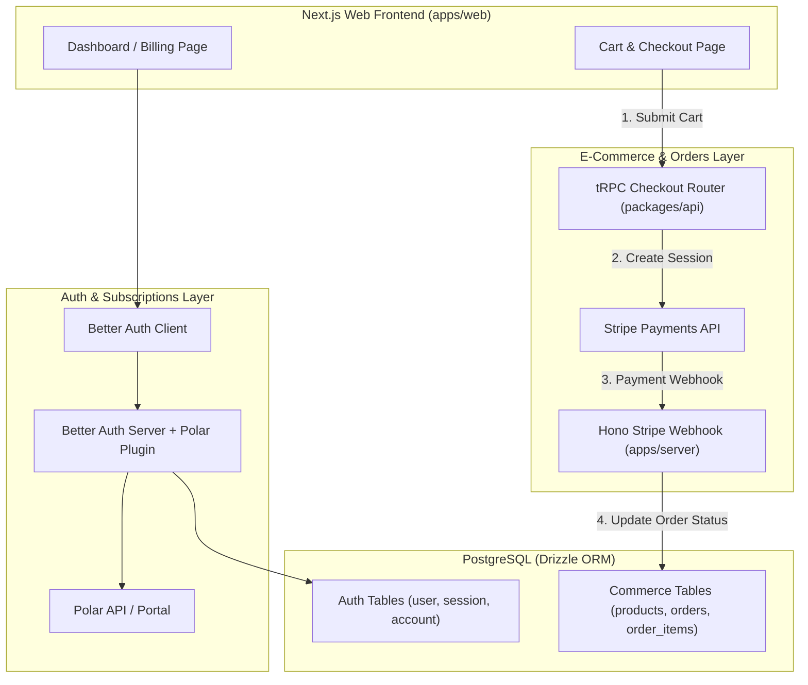

# Hybrid Payment Architecture: Polar & Stripe

This document outlines the architecture, data flow, database design, and implementation roadmap for supporting **Polar** (Merchant of Record for SaaS / developer tiers) alongside **Stripe** (Direct payment gateway for e-commerce cart checkouts).

---

## 1. Overview & Separation of Concerns

```
┌─────────────────────────────────────────────────────────────────────────────┐
│                              HONO-COMMERCE                                  │
├──────────────────────────────────────┬──────────────────────────────────────┤
│          POLAR (MoR)                 │          STRIPE (Gateway)            │
├──────────────────────────────────────┼──────────────────────────────────────┤
│ • Pro / Developer Subscriptions      │ • Storefront Shopping Cart           │
│ • Digital SaaS Access & Tiering      │ • One-time Product Purchases         │
│ • Automatic Global Tax & VAT (EU/US) │ • Physical & Custom Product Orders   │
│ • Self-serve Customer Billing Portal │ • Custom Checkout / Stripe Elements  │
│ • Integrated via Better Auth         │ • Integrated via tRPC + Hono Webhook │
└──────────────────────────────────────┴──────────────────────────────────────┘
```

---

## 2. System Architecture



---

## 3. Detailed Data Flows

### A. Polar Subscription Flow (SaaS / Tiers)

1. **Customer Provisioning**: On user signup, Better Auth automatically creates a Polar Customer via `createCustomerOnSignUp: true`.
2. **Subscription Checkout**: User clicks _Upgrade to Pro_ -> calls `authClient.checkout({ slug: "pro" })` -> redirected to Polar checkout.
3. **Status Check**: Frontend checks active subscription state via `authClient.customer.state()`.
4. **Subscription Management**: User clicks _Manage Subscription_ -> calls `authClient.customer.portal()` -> redirected to Polar customer billing portal.

### B. Stripe Cart Checkout Flow (E-Commerce Store)

1. **Cart Creation**: User selects products and navigates to checkout.
2. **Session Creation**: Frontend calls tRPC mutation `trpc.checkout.createSession.mutate({ items })`.
3. **Payment**: User inputs card details via Stripe Checkout or Stripe Elements.
4. **Webhook Processing**:
   - Stripe sends `checkout.session.completed` / `payment_intent.succeeded` event to `POST /api/webhooks/stripe`.
   - Hono verifies event signature using `stripe.webhooks.constructEvent`.
   - Order record updated in PostgreSQL to `status = 'paid'`.
   - Inventory decremented and confirmation notification triggered.

---

## 4. Proposed Database Schema Layout

Located in `packages/db/src/schema/`:

### `packages/db/src/schema/auth.ts` (Managed by Better Auth)

- `user`: Stores basic profile information.
- `session`: User sessions and authentication tokens.
- `account`: OAuth/credential providers.
- `verification`: Email/token verifications.

### `packages/db/src/schema/commerce.ts` (Store & Orders)

```ts
// Products Catalog
export const product = pgTable("product", {
  id: text("id").primaryKey(),
  name: text("name").notNull(),
  description: text("description"),
  priceInCents: integer("price_in_cents").notNull(),
  currency: text("currency").default("USD").notNull(),
  stock: integer("stock").default(0).notNull(),
  isActive: boolean("is_active").default(true).notNull(),
  createdAt: timestamp("created_at").defaultNow().notNull(),
  updatedAt: timestamp("updated_at").defaultNow().notNull(),
});

// Orders
export const order = pgTable("order", {
  id: text("id").primaryKey(),
  userId: text("user_id").references(() => user.id, { onDelete: "set null" }),
  stripeSessionId: text("stripe_session_id").unique(),
  stripePaymentIntentId: text("stripe_payment_intent_id").unique(),
  status: text("status", { enum: ["pending", "paid", "failed", "refunded"] })
    .default("pending")
    .notNull(),
  totalAmountInCents: integer("total_amount_in_cents").notNull(),
  currency: text("currency").default("USD").notNull(),
  customerEmail: text("customer_email").notNull(),
  shippingAddress: text("shipping_address"),
  createdAt: timestamp("created_at").defaultNow().notNull(),
  updatedAt: timestamp("updated_at").defaultNow().notNull(),
});

// Order Line Items
export const orderItem = pgTable("order_item", {
  id: text("id").primaryKey(),
  orderId: text("order_id")
    .notNull()
    .references(() => order.id, { onDelete: "cascade" }),
  productId: text("product_id")
    .notNull()
    .references(() => product.id),
  quantity: integer("quantity").notNull(),
  unitPriceInCents: integer("unit_price_in_cents").notNull(),
});
```

---

## 5. Implementation Roadmap & TODOs

### Phase 1: Polar Polish (Subscriptions)

- [ ] Replace placeholder `"your-product-id"` in `packages/auth/src/index.ts` with real Polar product IDs.
- [ ] Add Polar webhook secret configuration if custom subscription event tracking is required.
- [ ] Add subscription badge and gated feature checks in dashboard UI.

### Phase 2: Stripe Setup & Environment

- [ ] Install `stripe` package in `packages/api` and `apps/server`.
- [ ] Install `@stripe/stripe-js` in `apps/web`.
- [ ] Add environment variables to `packages/env/src/server.ts`:
  - `STRIPE_SECRET_KEY`
  - `STRIPE_WEBHOOK_SECRET`
  - `NEXT_PUBLIC_STRIPE_PUBLISHABLE_KEY`

### Phase 3: Commerce Schema & Drizzle Migration

- [ ] Create `packages/db/src/schema/commerce.ts` (products, orders, order items).
- [ ] Export schema in `packages/db/src/schema/index.ts`.
- [ ] Run `bun run db:generate` and `bun run db:migrate`.

### Phase 4: Backend Checkout & Webhooks

- [ ] Create `packages/api/src/routers/checkout.ts` for Stripe Checkout Session creation.
- [ ] Register `checkoutRouter` in `packages/api/src/routers/index.ts`.
- [ ] Add raw-body webhook handler in `apps/server/src/index.ts` at `/api/webhooks/stripe`.
- [ ] Implement signature validation and order status fulfillment handler.

### Phase 5: Web UI & Cart Experience

- [ ] Build product list and shopping cart components in `apps/web`.
- [ ] Integrate Stripe Checkout redirect or embedded Stripe Elements modal.
- [ ] Build order confirmation / success page (`/checkout/success?session_id=...`).
